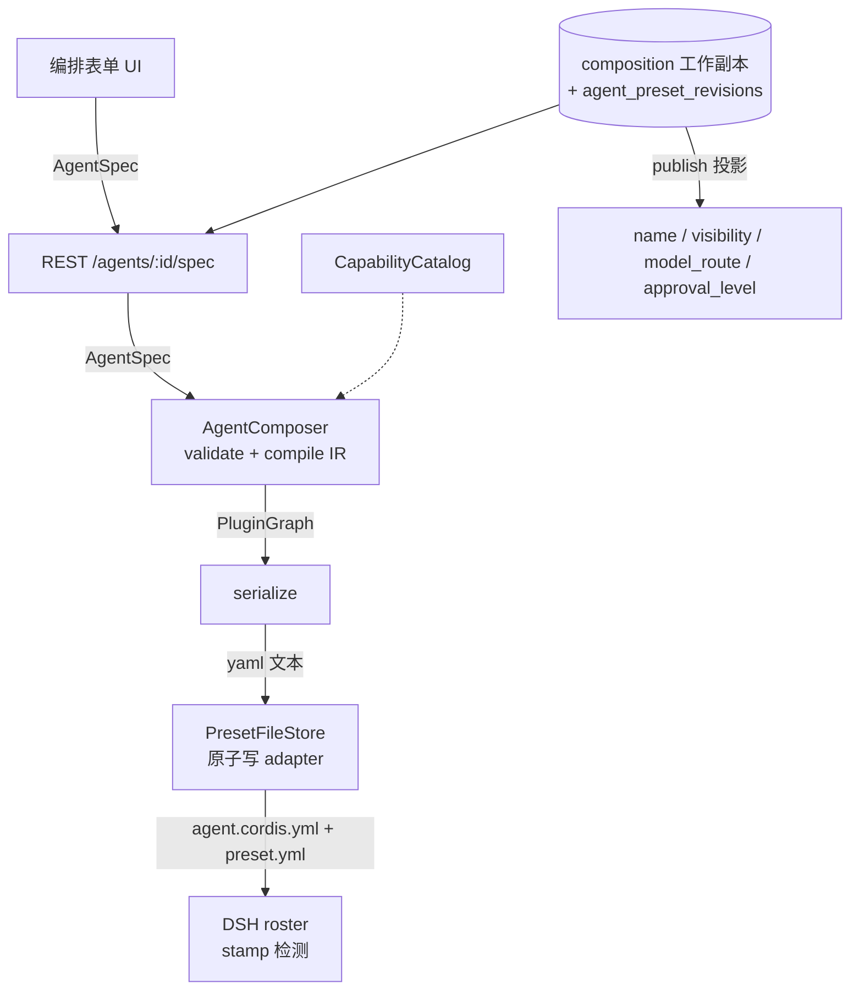

# Agent 编排方案设计

> Status: 已评审（按评审修订）
> 关联：12 Agent 商店 · 13 RBAC · 14 审批流 · 21 工作流模板
> 核心问题：目前「设计一个 Agent」= 手写 `agent.cordis.yml` + 目录上下架，没有可视化编排入口；
> `modelRoute` 存在 PG 却无消费点。本方案给平台补上「编排」这个缺失的产品功能。

---

## 1. 现状与问题

**DSH 原生机制**（`dsh-source/packages/preset/agent-presets/README.md`）：

- preset = 一个目录，含 `agent.cordis.yml`（agent-plane 插件组合）+ 可选 `preset.yml`（显示名/描述）。
- authoring **只支持复制**：`copy(from, id, name?)` 是唯一写入 seam。DSH 关掉了 composition-text 写入，因为 Loader 方言含 `!!js`（编辑 YAML = 代码执行）。
- **文件是唯一运行期编辑器**：改 `agent.cordis.yml` 后靠 mtime/size stamp 检测，新 session 挂新 generation，运行中 session 不变。
- mount 时校验：不可解析 YAML / 非插件行列表 / 非法 id / 服务发进 root realm（必须 `isolate`）都会拒绝。

**平台现状**（`apps/control-plane/src/agents/agents.service.ts`）：

- 只有目录管理：list/get/publish/unpublish/setVisibility/propose/approve/reject。
- `propose` 只能「基于模板复制 id/名称/描述」，`approve` 只是「复制模板目录的 `agent.cordis.yml` 原样过去」——**不能编辑编排内容**。
- `modelRoute` 存 PG `agent_presets.model_route`，全仓无运行期消费点——admin 只读展示，worker 不拿它配模型。
- 现网 4 个公司 preset（`presets/*/agent.cordis.yml`）只有两行：`dsh-system-prompt` 的 persona + `dsh-agent-default-model`。没有 bash / fs / subagent / ralph。
- MCP 挂在 host 层（`configs/company-profile/company/cordis.patch.yml` 的 `mcp-kb`），所以所有 Agent 都能看到 `knowledge_search`。`dsh-mcp-client` 要求 `serverName` 在进程内唯一，不能按 preset 各挂一份同名 server。
- `agent_presets.version` 已存在（upsert 时 +1）。控制面写的是 `trust: system` 的 `presets-company`——这是绕过 DSH copy-only 的特权写路径，本方案继续走这条路径，且它是该根的**唯一**写者。

**结论**：要补的是「受控的编排编辑 + 编译落盘 + 发布生效」。v1 产品面必须对齐现网差异（persona / 模型 / 哪些 MCP / 治理），而不是把 DSH `standard` 编码 Agent 的工具面板抬进领域模型。

---

## 2. 目标

1. 管理员/开发者能在 UI 里**设计一个 Agent**：改 persona、选模型路由、勾选 MCP、配审批级别与可见性。
2. 非技术用户**写不出 broken preset**：所有编排走白名单 + 编译校验，不暴露 raw cordis 语法。
3. 发布后**新会话生效、存量会话不受影响**（复用 DSH 的 stamp/generation 语义）。
4. 编排内容**版本化、可回滚、留审计**（谁在何时发布了什么）。

非目标（v1）：per-agent 编码工具面板（bash / fs / web / subagent / ralph）、YAML 反编译、人手改磁盘 YAML、DSH 重新开放 composition-text seam。

---

## 3. 设计原则

- **深度模块**：把 cordis 的复杂性（realm/isolate、host vs agent plane、插件白名单、YAML 序列化）藏在一个小接口后面。
- **薄 spec**：AgentSpec 只承载商店真正会改的字段。DSH `standard` 的工具开关、compaction 阈值、ralph.maxRounds 是编译器默认，不进接口。
- **seam 分层**：领域模型 → 编译器（IR）→ YAML 序列化 → 文件 adapter → DSH roster。
- **纯函数优先**：校验和编译无文件副作用；写文件隔离在 adapter。测试断言 IR，YAML 黄金文件只锁序列化方言。
- **两个 adapter 才有真 seam**：PresetFileStore 的生产 adapter 是磁盘，测试 adapter 是内存。不为「DSH 将来开放 composition-text」预留第三套——那条缝 DSH 刚关掉。
- **真源单一**：工作副本 + 已发布修订是编排真源；目录列是投影；YAML 是产物。

---

## 4. 领域模型

### 4.1 能力目录（CapabilityCatalog）——「平台现在能编排什么」

平台级硬编码清单（P0 不从网关/MCP 农场动态发现；直到清单真的会变再抽）。它不是某个 Agent 的配置：

```ts
interface CapabilityCatalog {
  models: ModelDef[]            // 可选模型路由（validate + 下拉）
  mcpServers: McpServerDef[]    // 可勾选的 MCP；连接配置归 host，见 §11 决策 6
  hostPlane: HostDef[]          // 只读展示：sandbox / approval / registries / persistence
}

interface ModelDef {
  provider: string
  model: string
  label: string
}

interface McpServerDef {
  serverName: string            // 与 host 层 dsh-mcp-client.config.serverName 一致，如 'kb' | 'db'
  label: string
  description: string
}
```

MCP **连接**（transport / command / url / 密钥）留在 host composition（今天的 `cordis.patch.yml`）。catalog 只提供可勾选的 id，避免把 stdio 命令和密钥编进每份 preset，也避开 `serverName` 进程内唯一约束。

### 4.2 编排规格（AgentSpec）——「某个 Agent 长什么样」

UI、API、编译器、修订表统一面对这个类型，**不面对 YAML**：

```ts
interface AgentSpec {
  id: string                                  // [a-z0-9][a-z0-9-]*，目录名，创建后不可改
  name: string
  description: string
  visibility: { departments?: string[]; roles?: string[] }
  approvalLevel: 'none' | 'self' | 'manager'

  modelRoute: { provider: string; model: string; pinned: boolean }

  persona: string                             // 编译为 dsh-persona.config.text（见 §11 决策 7）

  mcp: string[]                               // catalog.mcpServers[].serverName 的子集；空 = 不暴露任何 MCP 工具
}
```

v1 四个种子的意图（手写 spec，不做 YAML 反编译）：

| id | persona | modelRoute | mcp |
|---|---|---|---|
| assistant | 现网通用助手 | deepseek-official / flash，未钉 | `[]` |
| hr-assistant | 现网 HR 制度 | 同上 | `['kb']` |
| doc-search | 现网文档检索 | 同上 | `['kb']` |
| report-builder | 现网报表 | gateway / private/qwen-72b，钉死 | `[]`（`db` 尚未启用，进 catalog 后再勾；description 需同步对齐，避免展示「能查数据却无工具」） |

以后若要做 per-agent 工具面板，用 catalog 驱动的 `Array<{ id: string; enabled: boolean; config?: object }>`，不加 `tools.bash` 这类闭包字段。

---

## 5. 核心模块：AgentComposer（深度模块）

**接口（小）**：

```ts
interface AgentComposer {
  validate(spec: AgentSpec): ValidationResult
  compile(spec: AgentSpec): PluginGraph          // IR，不是 YAML
  serialize(graph: PluginGraph): string          // → agent.cordis.yml
  compileMeta(spec: AgentSpec): string           // → preset.yml
}

type PluginGraph = {
  rows: PluginRow[]                              // 已展开 isolate group 的插件行
}

type ValidationResult =
  | { ok: true }
  | { ok: false; errors: Array<{ path: string; message: string }> }
```

catalog 在构造时注入（生产一份、测试一份假目录），调用方不必每次传入。

调用者只需学 `AgentSpec` 和 validate / compile / serialize。REST 的「预览 YAML」= `serialize(compile(spec))`。

**实现（大）**——藏在接口后面：

1. **白名单校验**：`spec.mcp[]` 必须在 catalog 里；`modelRoute` 必须在 `catalog.models` 里；未知 id 报错。
2. **persona 行**：生成 `@deepseek-ai/dsh-persona`（`config.text` = spec.persona）。persona 经 YAML 库写成块标量，禁止字符串拼接。
3. **模型行**：生成 `@deepseek-ai/dsh-agent-default-model`（provider / model）。`pinned` **不**只写在 YAML 里——见 §11 决策 1。
4. **MCP 可见性**：不为每个 preset 编译一份 `dsh-mcp-client`（`serverName` 必须进程内唯一）。**spike 结论（已核实）**：`ctx.systemPrompt.tools()` scoped provider 只能**增加** schemas（合并语义，见 `packages/core/system-prompt/tests/scoped.spec.ts` "scoped providers are consulted only for their scope" 的合并断言），不能过滤；过滤要走 `ctx.tools.restrict({ allow?, deny? })`——DSH 现成的 scoped 过滤（`packages/core/tools/src/index.ts`：精确名匹配、未知名报错、只限 scoped context）。因 MCP 工具名 `mcp__<server>__<raw>` 是 mcp-client 运行期动态发现、编译期不可知精确名，故编译一条 preset 作用域的平台插件行 `@company/dsh-tool-mcp-visibility`（config.allowedServers = spec.mcp），该插件在 preset scope 内监听 MCP 工具注册、按 `mcp__<server>__` 前缀构造 `restrict({ deny })` 动态过滤；`mcp: []` 的 assistant 看不到 `knowledge_search`。插件实现落地在 `dsh-source/packages/platform/`。**剩余待验证**：restrict 的「未知名报错」与 MCP 异步注册的时序（deny 名单需在工具注册完成后才完整）。
5. **realm/isolate**：可见性插件若贡献 service，必须放进 `cordis:group` + `isolate`。规则由编译器决定。
6. **host-plane 边界**：sandbox / approval / registries / persistence / MCP 连接配置不进 spec。
7. **序列化**：YAML 库输出；**用户字符串永不进入非字面量位置**。编译器自身也不为用户字段发 `!!js`。产物文件头注释标明 generated，禁止手改。
8. **幂等**：同一 spec → 同一 IR → 逐字节同一 YAML（键排序稳定）。

**深度收益**：cordis 知识只维护一份；UI / REST / 测试走同一缝；插件增删只改 composer（+ catalog），不改 AgentSpec。

---

## 6. seam 分层



- Composer：纯函数，测试断言 `PluginGraph`。
- serialize：单独测方言（块标量、稳定排序、generated 头）。
- PresetFileStore：唯一碰磁盘的地方；生产用原子写（对齐 DSH `writeFileAtomic`），测试用内存。写的是 system-trust 的 `presets-company`，控制面是该根唯一写者。
- roster 不改：仍靠 stamp 发现变化。

---

## 7. 数据模型（PostgreSQL）

复用已有 `agent_presets.version` 作为**已发布修订号**。不新增 `spec_version`。迁移号接在现有 `007_users.sql` 之后（`008_agent_composition.sql`）。

```sql
ALTER TABLE agent_presets
  ADD COLUMN composition  JSONB,          -- 工作副本（编辑器所见；未发布的改动也在这里）
  ADD COLUMN updated_by   TEXT,
  ADD COLUMN updated_at   TIMESTAMPTZ NOT NULL DEFAULT now();

CREATE TABLE agent_preset_revisions (
  preset_id      TEXT NOT NULL REFERENCES agent_presets(id),
  version        INTEGER NOT NULL,
  spec           JSONB NOT NULL,          -- 该次发布的 AgentSpec
  compiled_yaml  TEXT NOT NULL,           -- 当时 serialize 的产物（审计 / 对照漂移）
  compiled_meta  TEXT NOT NULL,
  published_by   TEXT NOT NULL,
  published_at   TIMESTAMPTZ NOT NULL DEFAULT now(),
  PRIMARY KEY (preset_id, version)
);
```

| 存储 | 角色 | 规则 |
|---|---|---|
| `composition` | 工作副本 | PUT spec 只写这里，不 bump `version`，不写文件 |
| `agent_preset_revisions` | 已发布真源 | 每次 publish 插入一行，`version` 单调 +1；历史只追加 |
| `name` / `description` / `visibility` / `model_route` / `approval_level` | 目录投影 | **仅 publish 时**从该次 spec 覆写。禁止再单独 PATCH 这些列而不改 spec |
| `agent.cordis.yml` + `preset.yml` | DSH 运行产物 | 仅 PresetFileStore 在 publish/rollback 时原子写入 |

`version = 0`（或从未插入修订）表示从未发布。已上架但工作副本 ≠ 最新修订.spec → UI 显示「有未发布更改」；商店列表继续展示投影列（上次发布）。

回滚 = 读取目标修订的 `spec`，写入工作副本，再走一遍 publish（新版本，不改历史行）。

---

## 8. API 设计

| 方法 | 路径 | 作用 | 权限 |
|---|---|---|---|
| GET | `/capabilities` | 模型 + MCP 勾选清单 + host-plane 只读项 | 开发者/admin（不必对全体员工暴露内部 serverName） |
| GET | `/agents/:id/spec` | 默认工作副本；`?at=published` 为最新修订 | 可见者读 published；draft 仅开发者/admin |
| PUT | `/agents/:id/spec` | 保存工作副本。body 带 `expectedUpdatedAt`；冲突 409。validate 失败 422，不落库。**只写 `composition` 列的独立 UPDATE，不走 `upsertAgentPreset`（它每次 `version+1`，会把保存草稿误升为发布）** | 开发者/admin |
| POST | `/agents/:id/validate` | 只校验 | 开发者/admin |
| POST | `/agents/:id/publish` | 见 §10。body 带 `expectedVersion`（当前已发布号）；冲突 409 | admin |
| GET | `/agents/:id/revisions` | 修订列表 | admin |
| POST | `/agents/:id/rollback` | body `{ toVersion }` → 将该修订 spec 作为工作副本并 publish | admin |

`propose` / `approve` / `reject` 保留：

- `propose`：从模板的**已发布** spec 复制工作副本（改 id/name/description），`status=draft`，不写文件。模板没有 spec 则 422（种子必须先入库）。
- `approve`：对该 draft 走与 publish 相同的事务（不再复制模板 YAML）。
- 现有 `POST /agents/:id/publish`（只改 status）并入本 publish：未 compile、无修订、无文件，不算发布。

---

## 9. UI 设计

分栏编辑器，取代手改 YAML：

1. **左栏 · 能力目录**：模型列表、可勾选 MCP、只读 host-plane。没有 bash/fs/… 开关。
2. **中栏 · 编排表单**：persona、模型路由（含 pinned）、MCP 勾选、审批级别、可见性。
3. **右栏 · 只读预览**：`serialize(compile(spec))` + validate 错误，默认可折叠。不可编辑。
4. **顶部**：保存草稿 / 发布 / 回滚；展示 `version`、是否脏、最后编辑人。

商店卡片继续读投影列，不展示未发布 persona。

---

## 10. 发布流程

```
PUT 工作副本
  → validate → 422 或写入 composition（version 不变，不写文件）

POST publish（先 PG 提交、后写文件——文件系统非事务，见下方顺序理由）：
  1. 校验 expectedVersion == 行上 version，否则 409
  2. validate(composition)
  3. graph = compile(spec)；yaml = serialize(graph)
  4. 【PG 事务 commit】INSERT agent_preset_revisions (version+1, spec, yaml, …)
     + 行 version+1 + status=published + 投影列从 spec 覆写 + updated_*
     + audit_events 记 compose_publish
  5. 【commit 之后】PresetFileStore 原子写入 agent.cordis.yml + preset.yml
     （写失败 → 触发 rollback 回上一修订，或标漂移告警；绝不先写盘后入库）
  → roster 下次 list() 见到新 stamp
  → 新 session 挂新 generation；存量 session 不变

  顺序理由：roster 只认文件 stamp。「PG 先、文件后」的失败模式 = 发布未生效（靠漂移告警发现，可控）；
  「文件先、PG 后」的失败模式 = 运行着 PG 不认的无主版本（不可控）。两者都非原子，取前者。
```

`pinned: true` 的强制点在控制面创建会话与模型网关：拒绝会话级改模型。YAML 里的 `agent-default-model` 只是默认值；配额继续读投影列 `model_route`（与 YAML 在 publish 时同源）。

漂移：后台用 `serialize(compile(latestRevision.spec))` 的哈希对照磁盘；不一致则告警（P3）。文件头已标明 generated。

---

## 11. 现网迁移

不做 YAML → AgentSpec 反编译。现网 YAML 对不上薄 spec，persona 还挂在 `dsh-system-prompt` 上。

1. 按 §4.2 手写 4 份种子 spec，写入 `composition`（P1 迁移或种子脚本）。
2. 第一次 publish 将 YAML 从 `dsh-system-prompt.config.persona` 换成 `dsh-persona`。理由：`dsh-system-prompt` 是全局 `deployment:persona` 的 owner（process 唯一，README 明说 *"a process has exactly one"*），在 preset scope 里挂它做 per-agent 覆盖是可疑用法；`dsh-persona` 才是专门用来 shadow 部署 persona 的插件（README：*"shadow the deployment persona"*）。**迁移前先验证现网 4 个 preset 的 persona 是否真的 shadow 了全局 persona**——若未生效，则本次替换是 bugfix（修复 per-agent 身份）而非仅行为变更；无论哪种，产出 diff 都需评审确认 scope 遮蔽仍覆盖 host patch 的默认 persona。
3. host 层 `mcp-kb` **保留**（连接只有一份）。composer 的可见性行让 `mcp: []` 的 Agent 看不到 kb 工具——这是相对现网的产品变化（今天 assistant 也能搜知识库），发布前要验收。
4. 控制面成为 `presets-company` 的唯一写者；人手改 YAML 视为事故（P3 漂移告警）。

---

## 12. 关键决策

| # | 决策 | 结论 | 放弃什么 |
|---|---|---|---|
| 1 | 模型路由 | 进 AgentSpec；publish 时编译进 `agent-default-model` **并**覆写投影列。`pinned` 在创建会话 / 网关强制 | 只改 PG 列、worker 不消费；把钉死当成 YAML 注释 |
| 2 | 真源 | 工作副本 + revisions 为真源；列是投影；YAML 是产物 | 单独 PATCH visibility / modelRoute；人手改磁盘 YAML |
| 3 | 编排边界 | v1 只编 persona / modelRoute / mcp allowlist / 治理字段。host-plane 与 MCP **连接**不进 spec | 第一期做 DSH standard 工具面板 |
| 4 | 白名单 | 只能从 catalog 勾选模型与 MCP | 任意插件名、任意 YAML |
| 5 | 安全 | 用户输入只进 YAML 字面量（persona 走库转义）。控制面是 system 根的唯一写者 | 浏览器/API 接收 composition text；为用户字段发 `!!js` |
| 6 | MCP | 连接留 host（一份实例）。`spec.mcp` 是可见性 allowlist。不能按 preset 各挂同名 `dsh-mcp-client` | 把 mcp-kb 编进每个 preset（第二份 `serverName: kb` 会加载失败） |
| 7 | persona 插件 | 新编译走 `dsh-persona`：它是 shadow 部署 persona 的设计意图插件；`dsh-system-prompt` 是全局 owner，不能在 preset scope 正确做 per-agent 覆盖 | 与现网 YAML 逐字节兼容（现网 preset 的 persona 可能根本没生效） |
| 8 | 版本 | 复用 `agent_presets.version` 为已发布修订号。P1 就建 revisions。rollback = 新版本 | 第二套 `spec_version`；无历史的 rollback 路由 |
| 9 | 种子 | 手写 4 份 spec；第一轮 publish 的 YAML diff 当行为变更评审 | 反编译现网 YAML |

---

## 13. 分阶段实施

1. **P0 — 编译器 + catalog**：硬编码 models / mcpServers + `AgentComposer`（validate / compile IR / serialize）。黄金测试：4 份种子 spec 的 IR + YAML。**spike 已核实过滤 seam**：`tools.restrict()`（systemPrompt.tools 只能增不能减），MCP 可见性行定为平台插件 `@company/dsh-tool-mcp-visibility`；剩余验证 restrict 与 MCP 异步注册的时序、以及现网 preset 的 persona 是否真的 shadow 了全局 persona（定决策 7 是 bugfix 还是行为变更）。不做工具开关、反编译、编辑器。
2. **P1 — 存储 + API**：`008` 迁移（`composition` + `agent_preset_revisions`）、种子 spec 入库、`/capabilities`、GET/PUT spec、publish 事务（compile + 原子写 + 修订 + 投影列）、`expectedVersion` / `expectedUpdatedAt`。rollback 在修订表可查询的同一迭代落地，不是空路由。
3. **P2 — 编辑器 UI**：中栏薄表单接入 web/store；YAML 预览默认可藏。`propose` 改复制已发布 spec。
4. **P3 — 时间线 UI + 漂移告警**：修订列表、rollback 按钮、磁盘哈希对照。catalog 仍硬编码，直到 MCP 农场真会变（Rule of Three）。
