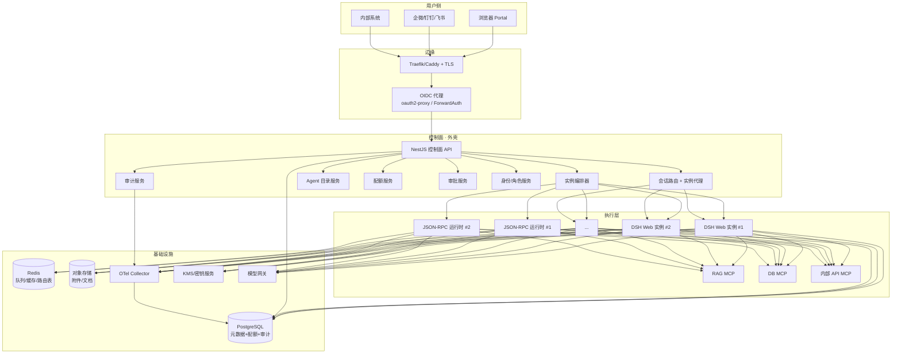
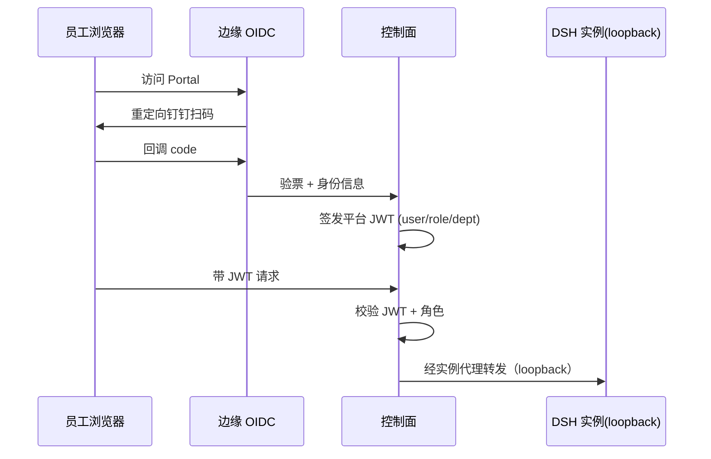
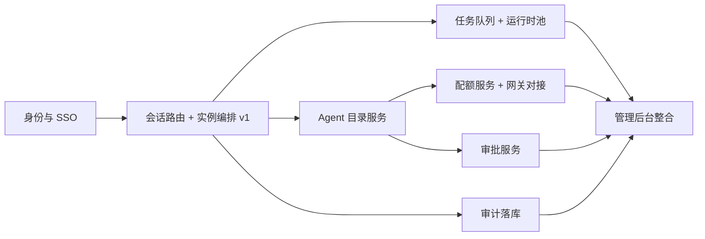

# 企业外壳架构草图 — 控制面设计

Status: draft for review
Companion to: `spec.md`（总览与路线图）
Scope: 平台层自建件（认证、实例编排、配额、审计、Agent 目录、审批、任务）

---

## 1. 目标与边界

### 1.1 外壳做什么

DSH 提供 Agent 内核，**外壳**提供企业化所需的一切：

| 能力 | 一句话职责 |
|---|---|
| 认证与身份 | SSO 登录（企微/钉钉/飞书）、用户/部门/角色、平台 JWT 签发 |
| 会话路由 | 用户 → 他的 DSH 会话/实例，跨设备恢复 |
| 实例编排 | DSH Web 实例与 JSON-RPC 运行时池的启停、健康、回收 |
| Agent 目录 | Agent 上架/下架、可见性、模型路由、审批级别 |
| 配额计量 | 用户/部门模型预算、限流、成本报表 |
| 审批 | 敏感工具调用的多级审批 + 授权存储（DSH 原生审批是一次性的） |
| 审计 | 全链路事件落库、脱敏、查询 |
| 任务 | IM 机器人/定时/API 触发的自动化任务队列 |
| 管理后台 | 上述一切的管理界面与 API |

### 1.2 外壳不做什么

- 不修改 DSH 内核、不 fork 上游（只依赖能力缝与配置）
- 不做模型推理、Embedding、向量检索（属能力层，见 spec.md）
- 不做数据面（会话事件仍由 DSH 写入，外壳只提供共享存储后端与元数据）

### 1.3 设计原则

1. **DSH 实例零信任于公网**：只监听 loopback，所有外部流量经边缘认证 + 控制面路由代理
2. **外壳与内核靠"缝"对接**：共享 SessionPersistence、集中 Credentials Provider、OTel 导出——都是 DSH 预留的替换点
3. **配额强制在网关**：模型网关是唯一硬执行点；外壳记录意图，网关执行预算
4. **每用户隔离**：用户数据（会话/工作区）物理分区，实例间不可互访

---

## 2. 总体拓扑



---

## 3. 模块设计

### 3.1 边缘与认证（Auth）

- **SSO**：**钉钉优先**（企微/飞书作为配置项）。OIDC 代理在边缘完成授权码流程，回调用户身份。
- **身份映射**：钉钉用户 id → 平台 opaque UUID；组织架构定时同步（cron 拉取部门树 → `departments` 表）。
- **平台 JWT**：OIDC 代理验票通过后，控制面签发短时 JWT（含 `user_id/role/dept`），Portal 与内部 API 一律携带。
- **角色**：`employee`（默认）/ `developer`（放开沙箱）/ `admin`（管理面）。角色由部门映射 + 本地覆盖表决定。
- **服务身份**：内部系统触发用 API Key（`api_keys` 表，存 hash），限定 scope（如 `task:create`）。



### 3.2 控制面 API（Node/TypeScript，NestJS + Fastify）

单体起步（模块内聚、可拆服务）。框架选 **NestJS（Fastify 适配器）**：模块化/DI 与外壳的多模块结构匹配；运行时驱动直接使用官方 TS SDK（`@deepseek-ai/dsh-sdk-client`），同语言零隔阂。核心路由草案见 §7。所有写操作走审计事件。

### 3.3 会话路由（Session Router）

- 表 `sessions` 是用户 ↔ 会话 ↔ 实例的映射中心。
- **交互会话**：`POST /api/sessions` → 按 `(user, agent_preset)` 查活会话；无则经编排器拿实例，记录路由。
- **路由安全**：实例 URL 含每会话随机 token（`routing_secret`），路由代理校验后才转发；用户只能命中自己的会话。
- **恢复**：实例重建后，会话从共享 SessionPersistence（PG 版）冷启恢复，用户无感。

### 3.4 实例编排器（Orchestrator）

**DSH Web 实例（交互）**

状态机：`cold → spawning → ready → busy → idle → reaping`

- 镜像：`dsh-web` 定制镜像（company profile bundle + 预设注入 env）
- 启动参数注入：`trustedHosts=控制面`、模型网关 `DEEPSEEK_BASE_URL`、MCP server 清单、preset 根（只读挂载公司目录）、OTel 端点、共享凭据 Provider
- 健康检查：控制面 loopback 探 `/healthz`，3 次失败 → 重启
- 空闲回收：`last_active + timeout` → 先 flush 会话再停容器；回收前通知前端
- 容量：同时在线上限（如 30）；超限 LRU 回收 + 队列提示

**JSON-RPC 运行时池（自动化）**

- N 个常驻 DSH 运行时进程，控制面（Node）以 **`@deepseek-ai/dsh-sdk-client`**（官方 TS SDK，JSON-RPC over stdio）驱动：`harness.run(task, { sessionId })`，每进程承载 M 个会话（`session_id` 隔离，`session_root` 指向共享卷）
- 任务从 Redis 队列取出，空闲运行时领取；崩溃 → 任务重试（会话可恢复）
- 池大小随负载弹性伸缩（按队列深度）

### 3.5 Agent 目录服务（Catalog）

- `agent_presets` 表 + 只读目录下发：发布到各实例的 preset 根（`dsh-agent-presets` 原生支持多根、实时重读）
- 上架/下架走管理 API；`visibility` 控制可见部门/角色；`model_route` 钉死敏感 Agent 的模型
- 版本化：preset 变更记录版本，会话在创建时 pin 版本

### 3.6 配额服务（Quota）

- **策略**：`quota_policies` 按 `(scope=user|dept, model_group, period)` 配置预算（token 数 / RPM / 成本额）
- **执行**：模型网关是唯一硬执行点（网关侧按 `X-User-Id` 头记账）；外壳 `quota_usage` 从网关计量回调聚合
- **降级**：超预算默认 `reject`；可配 `warn`（仅告警）
- **报表**：`GET /api/admin/usage/report` 出部门/个人成本报表（财务口径）

### 3.7 审批服务（Approval）

DSH 原生 `dsh-user-approval` 是一次性、无授权存储，外壳在其上补两层：

1. **授权存储**：`approval_requests` 持久化每次审批决策；同一用户对同一工具可配置"记住 X 小时"（allow-always 的受控版本）
2. **多级审批**：`approval_level`（如 DB 写 = 部门主管级）→ 待审批任务挂起，管理员/主管在 Portal 审批

对接点：DSH 侧敏感工具经 `dsh-tool-ask-user` 或审批策略钩子发起请求 → 外壳审批 API 回调（`GET /api/approvals/pending`、`POST /api/approvals/{id}/decide`）。

### 3.8 审计服务（Audit）

- **链路**：DSH OTel FULL 模式 → OTLP → Collector → 日志平台（公司现有或自建）
- **外壳事件**：登录、会话创建、任务、审批决策、管理操作 → `audit_events` 表（或同一管道）
- **脱敏**：DSH 侧 redaction waterfall + Collector 层规则双保险；API Key/凭据结构上不落日志
- **查询**：管理后台按用户/会话/时间/事件类型检索；单会话可导出 ZIP（原生支持）

### 3.9 任务服务（Tasks，Phase 3）

- `tasks` 表 + Redis 队列；触发源：IM 机器人、控制面 cron、内部系统 API Key
- 执行：运行时池领取 → `harness.run(task, session_id)` → 结果回写 → 触发方回执
- 定时：控制面 cron（比 `dsh-schedule` 的会话级提醒更适合平台级调度）

### 3.10 管理后台（Admin Console）

- 界面：用户/部门、实例、Agent 目录、配额、审批、审计、报表
- 前端：与 Portal 同仓的 React 应用，`admin` 角色可见

---

## 4. 数据模型（PostgreSQL 草案）

```sql
-- 身份与组织
CREATE TABLE departments (
  id uuid PRIMARY KEY,
  external_id text UNIQUE,          -- IDP 部门 id
  name text NOT NULL,
  parent_id uuid REFERENCES departments(id)
);
CREATE TABLE users (
  id uuid PRIMARY KEY DEFAULT gen_random_uuid(),
  external_id text UNIQUE,          -- IDP 用户 id
  idp text NOT NULL DEFAULT 'wecom',
  name text NOT NULL,
  dept_id uuid REFERENCES departments(id),
  role text NOT NULL DEFAULT 'employee',  -- employee | developer | admin
  status text NOT NULL DEFAULT 'active',  -- active | disabled
  created_at timestamptz DEFAULT now()
);

-- 会话与实例
CREATE TABLE sessions (
  id uuid PRIMARY KEY DEFAULT gen_random_uuid(),
  user_id uuid NOT NULL REFERENCES users(id),
  agent_preset_id text NOT NULL,
  type text NOT NULL DEFAULT 'web',        -- web | rpc
  instance_id uuid REFERENCES instances(id),
  routing_secret text NOT NULL,            -- 实例代理校验
  status text NOT NULL DEFAULT 'active',   -- active | idle | closed
  created_at timestamptz DEFAULT now(),
  last_active_at timestamptz DEFAULT now()
);
CREATE TABLE instances (
  id uuid PRIMARY KEY DEFAULT gen_random_uuid(),
  type text NOT NULL,                      -- web | rpc
  user_id uuid REFERENCES users(id),       -- web 实例归属用户；rpc 为 NULL（池）
  host text NOT NULL,
  port int NOT NULL,
  status text NOT NULL,                    -- spawning|ready|busy|idle|reaping|dead
  container_id text,
  spawn_at timestamptz DEFAULT now(),
  last_heartbeat timestamptz DEFAULT now()
);

-- Agent 目录
CREATE TABLE agent_presets (
  id text PRIMARY KEY,                     -- preset 目录 key
  name text NOT NULL,
  description text,
  visibility jsonb NOT NULL DEFAULT '{}',  -- {departments:[], roles:[]}
  model_route jsonb,                       -- {provider, model, pinned:bool}
  approval_level text NOT NULL DEFAULT 'none',
  status text NOT NULL DEFAULT 'published',-- draft|published|deprecated
  version int NOT NULL DEFAULT 1
);

-- 配额
CREATE TABLE quota_policies (
  id uuid PRIMARY KEY DEFAULT gen_random_uuid(),
  scope_type text NOT NULL,                -- user | dept
  scope_id uuid NOT NULL,
  model_group text NOT NULL,               -- private | cloud | all
  period text NOT NULL DEFAULT 'month',    -- day | month
  budget_tokens bigint,
  budget_rpm int,
  budget_cost_cents bigint,
  over_policy text NOT NULL DEFAULT 'reject' -- reject | warn
);
CREATE TABLE quota_usage (
  id uuid PRIMARY KEY DEFAULT gen_random_uuid(),
  policy_id uuid NOT NULL REFERENCES quota_policies(id),
  period_start date NOT NULL,
  used_tokens bigint DEFAULT 0,
  used_requests bigint DEFAULT 0,
  used_cost_cents bigint DEFAULT 0,
  updated_at timestamptz DEFAULT now(),
  UNIQUE (policy_id, period_start)
);

-- 审批（授权存储）
CREATE TABLE approval_requests (
  id uuid PRIMARY KEY DEFAULT gen_random_uuid(),
  requester_user_id uuid NOT NULL REFERENCES users(id),
  session_id uuid REFERENCES sessions(id),
  tool_name text NOT NULL,
  args_summary text NOT NULL,
  level text NOT NULL DEFAULT 'self',      -- self | manager
  status text NOT NULL DEFAULT 'pending',  -- pending|approved|rejected|cancelled
  decided_by uuid REFERENCES users(id),
  decided_at timestamptz,
  expires_at timestamptz
);

-- 任务（自动化）
CREATE TABLE tasks (
  id uuid PRIMARY KEY DEFAULT gen_random_uuid(),
  user_id uuid NOT NULL REFERENCES users(id),
  session_id uuid REFERENCES sessions(id),
  agent_preset_id text NOT NULL,
  payload jsonb NOT NULL,
  status text NOT NULL DEFAULT 'queued',   -- queued|running|done|failed|killed
  result jsonb,
  error text,
  created_at timestamptz DEFAULT now(),
  started_at timestamptz,
  finished_at timestamptz
);

-- 审计与密钥
CREATE TABLE audit_events (
  id bigserial PRIMARY KEY,
  user_id uuid REFERENCES users(id),
  session_id uuid REFERENCES sessions(id),
  event_type text NOT NULL,                -- auth.login|session.create|task.*|approval.*|admin.*
  payload jsonb,
  ts timestamptz DEFAULT now()
);
CREATE TABLE api_keys (
  id uuid PRIMARY KEY DEFAULT gen_random_uuid(),
  name text NOT NULL,
  key_hash text NOT NULL UNIQUE,           -- sha256，明文只展示一次
  scopes text[] NOT NULL DEFAULT '{}',     -- {task:create}
  owner_dept uuid REFERENCES departments(id),
  status text NOT NULL DEFAULT 'active',
  created_at timestamptz DEFAULT now(),
  last_used_at timestamptz
);
```

---

## 5. 关键技术选型（推荐 + 备选）

| 组件 | 推荐 | 备选 | 理由 |
|---|---|---|---|
| 控制面语言/框架 | **Node/TS + NestJS（Fastify）** | 纯 Fastify / Python FastAPI | 与 DSH 生态同语言；官方 TS SDK（`dsh-sdk-client`）直驱运行时 |
| 边缘 | Traefik + ForwardAuth | Caddy / nginx+oauth2-proxy | SSO 中间件生态成熟，配置即代码 |
| OIDC 代理 | oauth2-proxy（钉钉 OIDC） | 自研中间件 | 钉钉/企微/飞书 OIDC 兼容，零自研 |
| 实例容器 | Docker（Compose 起步） | K8s（若公司已有） | 50–500 人规模 Docker 足够，编排接口抽象可平移 |
| 模型网关 | LiteLLM（部署现成） | 自研轻量路由 | 混合路由/配额/密钥集中开箱即用 |
| 运行时驱动 | **TS SDK `@deepseek-ai/dsh-sdk-client`** | 裸 JSON-RPC / Python SDK | 官方支持，`harness.run` + 会话复用现成，与 NestJS 同栈 |
| 任务队列 | Redis + BullMQ | PG-backed | Node 生态成熟，容量足够 |
| 日志平台 | 公司现有（ELK/ClickHouse） | 自建 OTel Collector + 存储 | 审计链路复用公司设施 |
| 密钥 | 公司 KMS → 实现 `dsh-credentials` Provider | 自建 vault | 走 DSH 能力缝，零内核改动 |

---

## 6. 安全设计要点

1. **DSH 实例永不直接暴露**：loopback-only + `trustedHosts` 只含控制面；所有浏览器流量经路由代理（校验 JWT + routing_secret + 会话归属）
2. **每用户隔离**：实例/会话/工作区物理分区；路由表保证用户只可达自己的会话
3. **凭据集中**：API Key 只存 hash；模型密钥只在网关，DSH 侧经 KMS Provider 解析（配置零秘密）
4. **审批即闸门**：敏感工具（DB 写、对外发送）强制审批，决策留痕
5. **审计双保险**：DSH 侧 redaction + Collector 规则；登录/管理操作一律进 `audit_events`
6. **配额硬执行**：网关侧按身份头记账，超预算拒绝（外壳记录 ≠ 强制执行）
7. **任务防滥用**：API Key 限定 scope；IM 触发按用户身份限流

---

## 7. 接口契约草案（核心端点）

```
# 认证
GET  /auth/sso/login                      → 重定向 IDP
GET  /auth/sso/callback                   → 换平台 JWT

# 用户
GET  /api/me                              → {user, dept, role, quota_usage}

# 会话（交互）
POST /api/sessions                        → 创建/恢复会话（返回 routing token）
GET  /api/sessions                        → 我的会话列表
POST /api/sessions/{id}/close

# 实例代理（浏览器流量）
GET  /proxy/{session_id}/**               → 校验 JWT+routing_secret → 转发实例

# Agent 目录
GET  /api/agents                          → 可见的 Agent 列表（目录）
GET  /api/agents/{id}                     → 详情

# 任务（自动化）
POST /api/tasks                           → 提交任务（IM/内部系统/用户）
GET  /api/tasks/{id}                      → 状态与结果

# 审批
GET  /api/approvals/pending               → 待我审批的列表
POST /api/approvals/{id}/decide           → approve | reject

# 管理面（admin）
GET  /api/admin/instances                 → 实例池状态
POST /api/admin/agents                    → 上架/下架 Agent
POST /api/admin/quota/policies            → 配额策略
GET  /api/admin/usage/report              → 成本报表
GET  /api/admin/audit/events?user=&from=  → 审计检索
```

---

## 8. 开发顺序（依赖驱动）



| 步 | 模块 | 依赖 | 预估 |
|---|---|---|---|
| 1 | 身份与 SSO（企微 OIDC + 同步 + JWT） | — | 1–1.5 周 |
| 2 | 会话路由 + 实例编排 v1（Docker 启停/健康/回收） | 1 | 2 周 |
| 3 | 审计落库（OTel → Collector → 表/日志平台） | 2 | 0.5–1 周 |
| 4 | Agent 目录服务（preset 发布 + 可见性） | 2 | 1 周 |
| 5 | 配额服务（策略 + 网关计量对接 + 报表） | 4 | 1–1.5 周 |
| 6 | 审批服务（授权存储 + 多级审批） | 4 | 1 周 |
| 7 | 任务队列 + 运行时池（`dsh-sdk-client` 直驱） | 2 | 2 周 |
| 8 | 管理后台整合 | 3–7 | 1.5–2 周 |

与 spec.md Phase 1–3 对齐：步 1–3 ≈ Phase 1，步 4–6 ≈ Phase 2，步 7–8 ≈ Phase 3。

---

## 9. 已定决策与待决问题

### 已定（2025-08-16 评审确认）

| # | 决策 | 结论 |
|---|---|---|
| 1 | SSO 首发 | **钉钉**（企微/飞书留配置位） |
| 2 | 控制面技术栈 | **Node/TypeScript + NestJS（Fastify）**，运行时驱动用官方 `@deepseek-ai/dsh-sdk-client` |
| 3 | 容器编排 | **Docker 起步**，编排接口抽象预留 K8s 平移 |
| 4 | 模型网关 | **LiteLLM** 部署 |

### 待决

| # | 问题 | 我的推荐 | 影响 |
|---|---|---|---|
| 5 | 日志平台 | 复用公司现有（ELK/ClickHouse 等） | 否则审计管道要自建存储 |
| 6 | GPU/模型资源 | 私有 vLLM 至少 1 台（敏感场景） | 影响 Phase 0 试点模型体验 |

---

*注：本草案假定「每用户 Web 实例 + JSON-RPC 运行时池」的执行模型（spec.md ADR-1）。若执行模型调整，3.3/3.4/3.9 需相应修订。*
