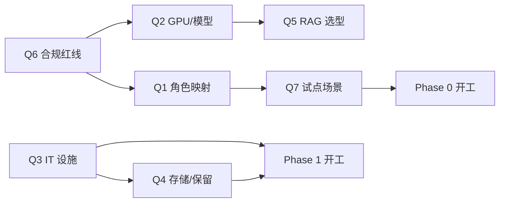

# Fog 集中评审材料

Status: ready for review
Date: 2025-08-16
Purpose: 逐项拍板 map.md Fog 中剩余的待定问题，评审后回填 map.md Decisions-so-far

---

## 0. 评审说明

- **用法**：建议一次 60–90 分钟评审会（或分两次：基础设施类 Q1–Q4 / 业务类 Q5–Q7），逐项过表，结论当场记录到 §9。
- **背景**：D1–D11 已定（SSO=钉钉、控制面=Node/TS NestJS、Docker 起步、网关=LiteLLM、运行时=TS SDK）。本材料只处理**仍需公司信息才能拍板**的问题。
- **会后动作**：把 §9 的结论回填 `map.md`（移出 Fog、记入决策表），并更新受影响的工单。

---

## 1. Q1 组织架构同步范围与部门→角色映射规则

| 项 | 内容 |
|---|---|
| 问题 | 钉钉组织架构同步哪些字段/范围？部门如何映射到平台角色（admin/developer/employee）？ |
| 为什么现在定 | 阻塞 07（SSO 同步）与 13（RBAC）的开工 |
| 阻塞工单 | 07, 13 |
| 选项 | A. 全组织只读同步 + 部门标签驱动角色（IT/研发=developer，其余=employee，指定部门=admin） B. 全量同步 + 角色完全靠本地覆盖表（灵活但维护成本高） C. 仅同步登录用户信息（组织架构不同步，角色手动配） |
| 推荐 | **A**：同步全组织（入职/离职/转岗自动生效），默认映射规则简单可预期，本地覆盖表只做例外（如个别业务线给 developer） |
| 所需信息 | 钉钉组织架构的部门命名/标签约定；admin 归属哪个部门或名单；是否有外包/临时员工需要独立角色 |

---

## 2. Q2 私有 GPU 资源与私有模型选型

| 项 | 内容 |
|---|---|
| 问题 | 私有化部署用什么 GPU（型号/数量/可扩容性）？私有模型选哪个？vLLM 部署规模？ |
| 为什么现在定 | 阻塞 03（模型网关）的私有路由配置与 Phase 0 试点的敏感场景体验 |
| 阻塞工单 | 03, 17（embedding 模型也吃 GPU）, Phase 0 |
| 选项 | A. 起步 1 台 8×A100/H100（或同档），Qwen2.5-72B-Instruct 主模型 + bge-m3 embedding B. 轻量起步 2×4090/3090，Qwen2.5-32B 档（省预算，能力弱一档） C. 混合：敏感场景小模型 + 高难任务审批后走云端 |
| 推荐 | **A 或 C**：先确认公司是否已有 GPU 资源池（很多公司已有训练/推理卡可共用）；模型首选 Qwen 系列（72B 档兼顾效果与部署成本），embedding 用 bge-m3 |
| 所需信息 | 现有 GPU 资源清单与占用情况；敏感场景的并发峰值估计（决定并发与显存）；预算区间 |

---

## 3. Q3 公司 IT/运维基础设施、发布流程与日志平台

| 项 | 内容 |
|---|---|
| 问题 | 公司有哪些现成设施可复用：容器平台（已有 K8s？）、CI/CD、日志平台（ELK/ClickHouse/Grafana？）、监控告警？ |
| 为什么现在定 | 决定 15（审计链路）是「对接现有」还是「自建」，也影响 06/08 的部署方式 |
| 阻塞工单 | 15, 06, 08 |
| 选项 | A. 有现成日志平台 → OTel collector 对接，审计零自建存储 B. 无日志平台 → 起步审计事件进 PG（`audit_events` 表）+ Grafana 看板，量大后迁 ClickHouse C. 已有 K8s → 实例编排直接上 K8s（D10 的抽象立即兑现） |
| 推荐 | **按实情组合**：日志平台有则 A，无则 B；K8s 有则 C，无则 Docker（D10 已定） |
| 所需信息 | IT 团队提供：容器平台、CI/CD、日志/监控、对象存储、KMS 的现状清单（有没有、归谁管、接入流程） |

---

## 4. Q4 会话存储分库与审计保留周期

| 项 | 内容 |
|---|---|
| 问题 | 会话事件 PostgreSQL 单库还是分库/分表？审计数据保留多久？合规要求是什么？ |
| 为什么现在定 | 影响 08（共享 SessionPersistence）的表结构与迁移策略；15（审计）的保留策略 |
| 阻塞工单 | 08, 15 |
| 选项 | A. 单库多 schema（session_events / platform_meta / audit）起步，容量不足再分表 B. 直接按用户哈希分表（提前复杂度） C. 会话事件与审计分两个库（物理隔离，运维重） |
| 推荐 | **A**：50–500 人规模单库足够（事件量大头是文本，起步估算 < 几十 GB/年）；预留分表迁移路径即可。审计保留建议 180 天–1 年（需合规确认），会话事件保留策略另定 |
| 所需信息 | 法务/安全是否有审计保留期限要求；公司数据库运维归属（自建 PG 还是用云 RDS） |

---

## 5. Q5 RAG embedding 模型与向量库选型、首批知识库范围

| 项 | 内容 |
|---|---|
| 问题 | 向量库用 Milvus / pgvector / Qdrant？embedding 用哪个模型？首批知识库放什么内容？ |
| 为什么现在定 | 阻塞 17（RAG MCP Server v1）的设计与 Phase 0 的首个 MCP 原型 |
| 阻塞工单 | 17, 04（首个 MCP Server）, 12（Agent 商店首批 preset 依赖知识库） |
| 选项 | 向量库：A. pgvector（复用 PG，运维面最小）/ B. Milvus（大数据量/高并发）/ C. Qdrant（中间档） embedding：bge-m3（中文强）/ 云端 API / 私有部署 |
| 推荐 | **pgvector + 私有 bge-m3**（起步）：复用 Q4 的 PG，少一个组件；切片量到百万级或并发上来再迁 Milvus（接口抽象好）。首批知识库 = 公司制度文档 + 高频 FAQ + 1 个业务部门的资料 |
| 所需信息 | 首批知识库候选文档清单与体量（决定是否现在就需要 Milvus）；知识库权限模型（哪些部门可见哪些文档） |

---

## 6. Q6 合规红线：数据分级、出境限制、脱敏级别、安全评审负责人

| 项 | 内容 |
|---|---|
| 问题 | 哪些数据严禁出境/进云端模型？日志脱敏到什么级别？安全评审谁负责？ |
| 为什么现在定 | 直接决定 03（模型路由策略）、15（审计脱敏）、13（权限边界）的硬约束 |
| 阻塞工单 | 03, 15, 13, 12（Agent 上架的数据敏感度标注） |
| 选项 | 数据分级：公开 / 内部 / 机密（机密严禁进云端模型，路由钉死私有） 脱敏：默认高级别（密钥/手机号/身份证等结构化字段 + 敏感词） |
| 推荐 | **数据分级 + 路由强制**：敏感 Agent 的 preset 模型路由钉死私有（网关兜底拒绝云端路由）；审计脱敏默认全量（宁可过脱不可漏）；安全评审由 IT/安全部门牵头，平台侧出清单供其审 |
| 所需信息 | 公司已有的数据分级制度（若无，需先立一个简版）；安全/法务负责人名单；是否有出境合规要求（如等保/行业监管） |

---

## 7. Q7 试点种子用户与首批高频场景

| 项 | 内容 |
|---|---|
| 问题 | 5–10 名种子用户选哪些人？首批试点的高频场景清单是什么？ |
| 为什么现在定 | 阻塞 05（试点）与 12（首批 Agent preset 的选型依据） |
| 阻塞工单 | 05, 12, 20（定时任务场景）, 21（工作流模板场景） |
| 选项 | 场景候选：制度/HR 问答、报销与财务流程、研发文档检索、周报/会议纪要生成、数据查询报表 |
| 推荐 | **跨 2–3 个部门选人**（避免单一部门偏见）：建议 3 名 HR/行政（制度问答）、3 名业务（流程咨询）、2–4 名研发/数据（文档检索+报表）。首批 3–5 个 Agent preset 从这些场景里提炼 |
| 所需信息 | 各部门的推荐人选；公司当前最费人力的重复任务 Top 5（向部门负责人收集） |

---

## 8. 评审依赖关系

**最小路径**：Q6（合规）→ Q2（GPU）→ Q7（试点）即可解锁 Phase 0；Q1/Q3/Q4 解锁 Phase 1；Q5 解锁 Phase 2 RAG。

---

## 9. 评审记录（2025-08-16 已完成）

| # | 问题 | 结论 | 决策号 | 日期 |
|---|---|---|---|---|
| Q1 | 组织架构同步与角色映射 | 全组织同步 + 部门标签驱动（IT/研发=developer、指定部门=admin、其余=employee），本地覆盖例外 | D12 | 2025-08-16 |
| Q2 | GPU 与私有模型 | 新购 1 台 8×A100/H100；模型 Qwen-72B 档（部署验证细化） | D13 | 2025-08-16 |
| Q3 | IT 设施与日志平台 | 有日志平台（OTel 对接）+ 对象存储；无 K8s（Docker 兑现）；无 KMS、CI/CD 未确认 → 转为执行级待办 | D14 | 2025-08-16 |
| Q4 | 存储分库与保留周期 | 单库多 schema 起步，预留分表路径 | D15 | 2025-08-16 |
| Q4b | 审计保留 | 180 天 | D16 | 2025-08-16 |
| Q5 | RAG 选型与首批知识库 | pgvector + 私有 bge-m3；首批=制度文档+FAQ+一个业务部门资料 | D17 | 2025-08-16 |
| Q6 | 合规红线 | 数据分级 + 机密钉死私有路由；审计全量脱敏；安全评审 IT/安全牵头 | D18 | 2025-08-16 |
| Q7 | 试点用户与场景 | 跨 2–3 部门 5–10 人；首批 4 场景：制度/HR 问答、报销/财务流程、数据查询报表、研发文档检索 | D19 | 2025-08-16 |

**评审后剩余执行级待办**（已同步至 map.md Fog）：试点人选名单、安全评审对接人、KMS 自建或对接、CI/CD 接入、GPU 采购流程。
