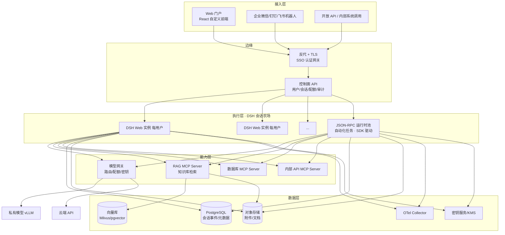

# 公司内部 AI Agent 使用平台 — 架构设计与实施路线图

Status: drafting
Created: 2025-08-16
Owner: AI 平台部 / 算法部（大模型应用组）

---

## 1. 背景与目标

### 1.1 背景

公司计划搭建内部统一的 AI Agent 使用平台，让非技术同事也能把重复、费时的工作真正交给 AI「做完」（而非仅「回答」）。平台定位为**综合平台**：既提供员工日常 AI 助手能力（问答/写作/知识检索），也提供业务自动化 Agent（自主执行任务、调用内部系统），并统一管理模型、权限、成本与审计。

技术路线经评估确定：**基于 DeepSeek Harness（DSH, `@deepseek-ai/dsh` v0.1.0-rc）扩展**，而非从零自研 Agent 运行时。DSH 提供了完整且高质量的 Agent 内核（模型适配、工具、会话、子代理、工作流、审批、沙箱、遥测），且以**能力缝（capability seam）**设计，允许平台层替换存储、凭据、遥测等后端而不改内核。

### 1.2 目标

| 维度 | 目标 |
|---|---|
| 用户规模 | 50–500 名内部员工，普通员工 + 管理员 + 开发者三类角色 |
| 模型策略 | 混合：敏感数据走私有化部署模型，通用场景走云端 API |
| 核心能力 | 多类型 Agent 目录、多轮对话、工具调用、知识库 RAG、定时任务、IM 机器人入口 |
| 治理 | 统一身份（SSO）、分级权限、审批流、全量审计、成本计量 |
| 集成 | 钉钉身份（首发，企微/飞书可扩展）、内部知识库、数据库/内部 API |
| 时间线 | 3 个月以上，分 4 个阶段交付，先试点后推广 |

### 1.3 成功标准

- 员工用一句话能描述「平台上的 Agent 能帮我干什么」，并独立完成一个自动化任务
- 平台可观测：每一次 Agent 执行有完整审计轨迹，成本可核算到部门/个人
- 模型与工具接入新成员（新模型、新 MCP 工具）不改内核，靠配置/插件完成
- 安全事故（越权工具调用、数据泄露）可定位、可追溯、可复现

### 1.4 非目标（v1）

- 不做模型训练/微调（只做部署与路由）
- 不要求 100% 自动化正确率——人审兜底是设计的一部分
- 不做外部客户面向的多租户 SaaS 化

---

## 2. 现状勘察：DSH 能力盘点

基于对 DSH 源码与本地安装包（100+ 插件包）的勘察，能力矩阵如下。

### 2.1 可直接复用的能力（现成）

| 能力域 | DSH 包 | 说明 |
|---|---|---|
| Agent 运行时 | `dsh-agent`, `dsh-agent-loop` | Agent 注册表、生命周期事件（created/session-start/pre-step…）、inbox、followup/steer/inject、取消 |
| Agent 目录 | `dsh-agent-presets` | **每个 preset 是独立 agent 组合**（工具+提示词+投影），可直接作为「Agent 商店」机制 |
| 子代理/编排 | `dsh-subagent-*`, `dsh-workflow` | 子代理委派、模型编写的编排脚本（可扇出子代理） |
| 长期目标 | `dsh-goal`, `dsh-goal-round-driver` | 跨轮次的长任务目标驱动 |
| 工具 | `dsh-tool-bash/fs/web/...` + `dsh-tools` | 内置工具集；沙箱化执行 |
| MCP 客户端 | `dsh-mcp-client` | 传输支持 **stdio + streamable-http**（无旧版 SSE-only）、断线重连、工具同步——**外部能力接入主通道** |
| 模型适配 | `dsh-llm-*`（deepseek/pi-ai）+ `dsh-llm-retry` | 适配器模式（`ctx.llm.registerAdapter`），可加新 provider；pi-ai 已支持 OpenAI 兼容端点 |
| 会话 | `dsh-session-*`, `dsh-session-persistence` | 事件溯源模型，JSONL.zstd / SQLite 后端，**持久化是能力缝**可替换 |
| 凭据 | `dsh-credentials` | 配置只存引用不存秘密，**Provider 是可替换缝**（现为本地 .credentials.yaml） |
| 权限/沙箱 | `dsh-sandbox-*`, `dsh-permission-presets` | workspace-write / danger-full-access 预设、文件效应策略 |
| 审批 | `dsh-user-approval`, `dsh-tool-ask-user` | 用户确认流、向用户提问工具；**注意：审批是一次性的，无 allow-always、无授权存储**——平台层需自建授权存储与多级审批 |
| 遥测 | `dsh-session-telemetry-otel` | OpenTelemetry 导出（FULL/FEEDBACK_ONLY/DISABLED），含脱敏瀑布钩子；**collector/存储/查询需自建** |
| 计量 | `dsh-token-meter`, `dsh-session-stats` | 会话 token 计量、耗时统计——成本核算基础；**仅统计，无限流/配额执行** |
| 定时 | `dsh-schedule` | 持久化的定时提醒/任务（版本 1） |
| Web UI | `dsh-web-app` + `dsh-client-ui-*`（40+ 包） | React 界面：对话、模型选择、设置、任务、工作流运行等 |
| 无头执行 | `dsh-headless` | 一次性任务执行、无 HTTP——**服务端 API 化执行引擎** |
| 嵌入式运行时 | `@deepseek-ai/dsh-sdk-client`（TS SDK，与 Python SDK `deepseek-harness-sdk` 同协议）+ `dsh-sdk-jsonrpc-server` | **官方双 SDK**：子进程 + JSON-RPC over stdio 驱动运行时，`harness.run(task, session_id)` 复用会话/持久 shell；支持自定义 cordis 组合——**控制面嵌入/驱动执行层的官方通道**（控制面已定 Node/TS，用 TS SDK）。另有 ACP 协议（`dsh-acp`） |
| API/BFF | `dsh-api-gateway`, `dsh-api-remotes`, `dsh-client-connection` | Typert RPC、宿主能力 BFF、浏览器信任围栏 |

### 2.2 需平台层补齐的缺口（企业化改造点）

| 缺口 | 现状证据 | 平台层方案 |
|---|---|---|
| 无认证/多用户 | `dsh-host-webserver` README 明示 "No TLS, auth, or origin policy…v1 刻意不做"；`dsh-client-connection` 的 /api 围栏 "is a reachability policy, not authentication"；`--host 0.0.0.0` 被显式拒绝 | 反代层 SSO（见 ADR-2），DSH 实例保持无认证 |
| 单机单用户 | 每个 DSH 进程 = 一个 Host + 一个浏览器客户端；`$DSH_HOME` 是单一信任域 | 会话农场/每用户实例（见 ADR-1） |
| 会话本地存储 | 持久化 JSONL.zstd / SQLite 落 `$DSH_HOME` 本地盘 | 实现共享 `SessionPersistence` 后端（PostgreSQL/S3） |
| 凭据分散 | `dsh-credentials-local` 读进程环境 + 本地 `.credentials.yaml`，无 vault | 实现集中凭据 Provider（KMS/公司密钥服务） |
| 无 RAG | 全仓无 embedding/向量库/文档摄取实现，知识来源全靠 MCP/外部工具 | 自建 RAG MCP Server（见 ADR-4） |
| 无 IM 入口 | DSH 仅 Web/终端/ACP | 控制面桥接企业微信/钉钉/飞书机器人 |
| 无组织架构/配额 | 无租户概念；全仓无限流/配额包，token-meter 仅统计 | 控制面维护用户/部门/配额 + 网关层限流 |
| 模型密钥管理 | 单 key 环境变量（write-only 设置页） | 模型网关统一路由 + 配额（见 ADR-3） |
| 审批无授权存储 | `dsh-user-approval` 一次性审批（allowed-once），无 allow-always | 平台层自建授权存储 + 多级审批工作流 |
| 审计无收集端 | OTel 导出器已具备，但 collector/存储/查询需自建 | OTel collector + 公司日志平台接入 |
| pre-release 风险 | README 明示 "THERE WILL BE COMPATIBILITY-BREAKING CHANGES"；`SESSION_FORMAT_VERSION=0` 无兼容承诺 | 锁定版本 + 冻结格式 + 集成测试；跟踪首个 tagged release |

### 2.3 结论

DSH 的**内核能力全部现成**，企业化改造集中在**外围**：认证、实例编排、共享存储、集中凭据、RAG、IM 桥。这正符合「基于 DSH 扩展」的路线——不改内核，围绕能力缝做平台层。

---

## 3. 目标架构

### 3.1 各层职责

- **接入层**：员工使用入口。Web 门户是主界面（对话、Agent 目录、任务中心、用量看板）；IM 机器人把入口延伸到日常工具；开放 API 供内部系统触发 Agent。
- **边缘**：反向代理终止 TLS 并做 SSO 认证（**钉钉 OIDC 首发**，企微/飞书为配置项；组织架构同步），把用户身份注入请求头；控制面 API 负责实例编排、会话路由、配额校验、审计落库。
- **执行层**：DSH 运行时池。交互式会话跑在每用户 DSH Web 实例（懒启动 + 空闲回收）；自动化任务（IM 触发、定时、API 触发）跑在 **JSON-RPC 运行时池**——基于官方 TS SDK（`@deepseek-ai/dsh-sdk-client`）的常驻运行时进程，控制面（Node/TS + NestJS）通过 JSON-RPC 驱动，会话按 `session_id` 复用，`session_root` 指向共享存储。
- **能力层**：模型网关统一暴露一个 OpenAI 兼容端点（背后是私有 vLLM + 云端 API 的混合路由）；MCP Server 农场承载 RAG、数据库、内部 API——每个都是标准 MCP 协议，通过 `dsh-mcp-client` 按 Agent 挂载。
- **数据层**：PostgreSQL 存会话事件与平台元数据；对象存储存附件与文档；向量库存知识库切片；OTel 承载审计与监控；KMS 集中管密钥。

### 3.2 一次典型交互的旅程

员工在钉钉里 @机器人 → 机器人回调控制面 → 控制面鉴权（SSO 票据）→ 路由到该员工的 JSON-RPC 会话（无则冷启动）→ Agent 加载 preset 工具集（含 RAG MCP 检索公司知识库）→ 必要时发起工具调用审批 → 结果回写会话事件 → 机器人回复 → 全程审计轨迹进 OTL。

---

## 4. 关键技术决策（ADR）

### ADR-1 多用户模型：每用户实例 + JSON-RPC 运行时池，不做多租户内核改造

- **决策**：交互式会话采用「懒启动的每用户 DSH Web 实例」（容器化，空闲回收，同时在线控制在资源预算内）；自动化任务采用 **JSON-RPC 运行时池**——官方 TS SDK（`@deepseek-ai/dsh-sdk-client`）驱动的常驻运行时进程，控制面（Node/TS + NestJS）统一调度，每个用户会话有独立 `session_root` 工作区与 `session_id`。
- **理由**：DSH 是单用户产品架构（单 Host/单客户端/本地盘），多租户改造等于 fork 上游、长期背负合并成本；DSH 处于 0.1.0-rc 高频迭代期，保持跟随上游收益大。每用户实例天然隔离、可按用户配资源、故障爆炸半径小。SDK 是官方支持的嵌入式通道（JSON-RPC over stdio、会话复用、持久 shell、自定义 cordis 组合），比裸跑 CLI 进程更可控、更省资源。
- **代价**：控制面实例编排层需自建（启动/路由/回收/健康检查）。
- **可回退**：若实例资源成本过高，可将同一用户的多实例合并为一个常驻会话（headless 模式），损失部分 UI 能力。

### ADR-2 认证：反代 SSO 前置，DSH 保持无认证

- **决策**：认证完全放在反向代理层（**钉钉 OIDC 首发**，企微/飞书为配置项，支持组织架构同步与部门映射）；DSH 实例只监听 loopback，由控制面转发流量并注入可信身份头。
- **理由**：DSH v1 明确无认证；在反代层做 SSO 是标准做法，与 DSH 的浏览器信任围栏（trustedHosts）机制兼容——控制面是唯一可信 Host。
- **细节**：管理员角色来自 SSO 组织架构映射；控制面持有用户→会话映射，任何外部请求先过控制面鉴权再触达 DSH。

### ADR-3 模型网关：统一 OpenAI 兼容端点 + 混合路由

- **决策**：自建/部署一个模型网关（如 LiteLLM 或自研轻量路由），统一暴露 OpenAI 兼容 API；DSH 侧只需一个适配器指向网关。网关内做：私有 vLLM（敏感场景）与云端 API（通用场景）路由、每用户/部门配额、密钥集中管理、用量计费数据。
- **理由**：DSH 适配器是「一 provider 一适配器」，给每个模型都写适配器不可维护；网关把模型多样性收敛为单一协议，DSH 零改动。混合策略天然落位：按 Agent/数据敏感度路由到私有或云端。
- **注意**：敏感 Agent 的 preset 必须将模型路由钉死在私有模型；网关侧再做一层强制策略兜底。

### ADR-4 RAG：自建 MCP Server，不侵入内核

- **决策**：RAG 能力（文档接入、解析、切片、Embedding、向量检索、重排）做成独立服务，对外暴露标准 MCP（streamable-http），由 `dsh-mcp-client` 挂载到需要的 Agent preset。
- **理由**：DSH 无内置 RAG；MCP 是 DSH 官方支持的外部能力通道（README 明示），协议标准化，后续可换商用/开源实现。
- **实施**：文档权限控制放在 MCP Server 内（按用户/部门过滤检索结果），比在 Agent 层做更可靠。

### ADR-5 会话存储：实现共享 SessionPersistence 后端

- **决策**：按 DSH 能力缝规范实现 PostgreSQL 版 `SessionPersistence`（事件溯源存储），使会话跨实例、跨设备可恢复；附件走对象存储。
- **理由**：能力缝就是为此设计的（Service Definition + Provider 分离）；每用户实例的本地盘不适合承载会话资产。
- **注意**：需遵循缝的不变量（append-only、seq 连续、崩溃收尾），并保留 JSONL 本地回退用于开发调试。

### ADR-6 Agent 目录：presets + 平台级目录服务

- **决策**：Agent 类型 = DSH preset（目录内 `agent.cordis.yml` 组合）。平台控制面维护「Agent 商店」：上架/下架、可见部门、默认模型路由、配额、审批级别；运行期由 `dsh-agent-presets` 挂载。
- **理由**：preset 机制开箱即用且支持热加载（列表实时重读）；「商店」概念对非技术员工友好。
- **注意**：preset 目录的写权限收敛到管理员；员工自建 preset 走审核流程。

---

## 5. 分阶段实施路线图

### Phase 0 — 地基与试点（第 1–2 周）

**目标**：一条完整链路先跑通，证明「DSH + 公司配置」能服务真实任务。

- [ ] 搭建 DSH 开发环境（源码 clone、`pnpm build`、本地 web profile）
- [ ] 公司级 profile：统一 persona、中文提示词基座、内网模型网关端点
- [ ] 部署模型网关（LiteLLM：私有 vLLM 1 台 + 云端 API 混合路由），DSH 指向网关
- [ ] 第一个内部 MCP Server（如：公司制度文档检索）接进 `dsh-mcp-client`
- [ ] 试点 5–10 名种子用户，收集真实任务样例

**出口条件**：种子用户完成 ≥1 个真实任务的端到端自动化；确定平台主用场景清单。

### Phase 1 — 多用户与身份（第 3–6 周）

**目标**：从单机走向服务化，50 人可用。

- [ ] 控制面骨架（Node/TS + NestJS，容器化 DSH Web 实例懒启动 + 空闲回收，详见 enterprise-shell §3.2–3.4）
- [ ] 反代 + TLS + SSO（钉钉 OIDC 首发，企微/飞书为配置项；平台 JWT 签发）
- [ ] 共享 `SessionPersistence`（PostgreSQL）与附件对象存储
- [ ] 集中凭据 Provider（KMS 对接）
- [ ] 管理后台 v1：用户、实例、模型配置、会话列表
- [ ] 试点扩到 30–50 人

**出口条件**：50 名员工通过钉钉扫码登录，会话跨设备可恢复；管理员可看到每会话审计记录。

### Phase 2 — Agent 目录与治理（第 7–10 周）

**目标**：把「工具」变成「产品」。

- [ ] Agent 商店（presets 目录服务 + 上架审核 + 可见性控制）
- [ ] 权限分级：普通员工（workspace-write + ask）/ 开发者（danger-full-access）/ 自定义
- [ ] 审批流完善：敏感工具（数据库写、对外发送）强制审批
- [ ] 审计与用量：OTel FULL 导出 + 脱敏规则 + 成本看板（token-meter/session-stats 数据上卷）
- [ ] 配额与限流：按部门/个人模型预算
- [ ] RAG MCP Server v1（公司知识库，权限过滤检索）

**出口条件**：管理后台可完成 Agent 上架/下架；财务口径的成本报表生成；越权工具调用被拦截并留痕。

### Phase 3 — 知识库与自动化（第 11–14 周）

**目标**：让 Agent 主动干活。

- [ ] IM 机器人接入（钉钉优先，企微/飞书可扩展：对话入口 + 任务触发 + 结果推送）
- [ ] JSON-RPC 运行时池 + 任务队列（基于 `@deepseek-ai/dsh-sdk-client`，Redis + BullMQ，IM 触发、定时任务、API 触发）
- [ ] 定时 Agent（基于 `dsh-schedule` 或控制面 cron）
- [ ] 复杂工作流：子代理编排模板（报表生成、周报汇总等高频场景）
- [ ] 反馈闭环：会话反馈收集、效果评估、prompt 迭代
- [ ] 全量推广（100–500 人）+ 上线培训

**出口条件**：≥3 个高频业务场景完全自动化；机器人周活 > 60% 试点部门员工；故障/事故可复盘。

---

## 6. 团队配置（对照 JD）

| 角色 | 人数 | 对应 JD 职责 |
|---|---|---|
| AI 工程师（大模型应用，初级，P4–P5） | 2–3 | RAG 工程、Agent 框架维护、Prompt 调优、工具封装——**JD 主体** |
| 后端/平台工程师 | 1–2 | 控制面（**Node/TS + NestJS**）、SSO、实例编排、共享存储、配额审计 |
| 前端工程师 | 1 | Web 门户、Agent 商店 UI、管理后台（React） |
| 资深架构师/技术负责人 | 1（可由组长兼） | 架构决策、DSH 上游跟踪、代码评审 |
| 产品/运营 | 1（可兼） | 场景收集、试点推广、培训、效果评估 |

JD 中「参与公司大模型应用平台的搭建与迭代（RAG 知识库问答、智能助手、Agent 工作流）」「Function Calling / 工具调用、多轮对话状态管理、任务编排」「将大模型能力封装为可复用、可观测的 API 服务」与 Phase 0–3 的工作项一一对应。

> **注意（技能匹配）**：JD 要求 Python 扎实，而控制面技术栈已定为 Node/TS（NestJS）。需在 JD 中补充 Node/TypeScript 要求，或为平台工程师岗单列 TS 技能项——AI 工程师仍以 Python 为主（RAG/工具服务/评估脚本），两条技能线并存。

---

## 7. 风险与对策

| 风险 | 影响 | 对策 |
|---|---|---|
| DSH 处于 pre-release（0.1.0-rc），README 明示 "THERE WILL BE COMPATIBILITY-BREAKING CHANGES"，`SESSION_FORMAT_VERSION=0` 无兼容承诺 | 平台层代码/存量会话失配 | 锁定版本跟随；平台层只依赖能力缝接口；会话格式冻结与迁移测试；跟踪首个 tagged release |
| 多用户实例资源成本失控 | 预算超标 | 懒启动 + 空闲回收 + 并发上限；成本看板按实例核算 |
| RAG 检索质量不达预期 | 员工弃用 | 先做高频小知识库试点；引入重排；把「检索不到」反馈闭环做进产品 |
| 权限/审批过严或过松（审批原生一次性、无授权存储） | 安全或效率失衡 | 分级预设 + 每 Agent 审批级别 + 平台层授权存储与多级审批 + 试点期调参 |
| 员工对 Agent 期望过高 | 信任崩塌 | 明确能力边界、人审兜底设计、失败复盘文化 |
| 私有模型效果不足 | 敏感场景体验差 | 混合路由兜底：敏感场景允许白名单模型 + 人工审批降级到云端 |
| MCP 传输兼容 | 部分第三方 MCP 服务无法接入（仅 stdio/streamable-http，无 SSE-only） | 选型时核对传输；自建服务一律用 streamable-http |

---

## 8. 里程碑与验收

| 里程碑 | 时间 | 验收 |
|---|---|---|
| M0 单链路打通 | 第 2 周末 | 1 个真实任务由 Agent 端到端完成 |
| M1 50 人可用 | 第 6 周末 | SSO 登录、会话恢复、审计可见 |
| M2 治理完备 | 第 10 周末 | Agent 商店上线、成本报表、越权拦截留痕 |
| M3 自动化规模 | 第 14 周末 | IM 入口 + ≥3 场景自动化 + 定时任务 |

---

---

## 附录：参考材料

- **架构与路线图**：本文档（spec.md）
- **企业外壳设计**：`.scratch/ai-agent-platform/enterprise-shell.md`（控制面：§3 模块、§4 数据模型、§5 选型、§7 接口契约、§8 开发顺序）
- **集中评审**：`.scratch/ai-agent-platform/fog-review.md`（Fog 剩余问题的评审材料）
- **调研报告**：`.scratch/ai-agent-platform/research-report.md`（131 行完整评估，全部结论附包名/路径/README 引文证据）
- **DSH 源码克隆**：`dsh-source/`（105MB，depth 50，HEAD = 0.1.0-rc.5，2026-08-13 公开版；本机 npm 安装为 0.1.0-rc.6，更新一档）
- 文档基于对 DSH v0.1.0-rc.6（本地安装）与 rc.5（仓库 HEAD）的勘察编写；随 DSH 上游演进需定期复核。技术细节以 DSH README 与源码为准。
