# 公司 AI Agent 平台 — arc42 架构文档

| 项 | 值 |
|---|---|
| 系统 | `ai-agent-platform`（公司内部 AI Agent 使用平台） |
| 状态 | 按 **2026-09-05 仓库代码** 描述现状，不是远期蓝图 |
| 读者 | 平台工程师、架构评审、接手维护的 AI 工程师 |
| 上游内核 | DeepSeek Harness（DSH）`0.1.3-alpha.1`，vendor 于 `dsh-source/` |
| 姊妹文档 | `spec.md`（目标与 ADR）、`enterprise-shell.md`（外壳草图）、`map.md`（决策表）、`STATUS.md`（工单进度）、`RUN-LOCALLY.md`（本地跑通） |

本文档遵循 [arc42](https://arc42.org) 十二章。图一律用 mermaid。与代码冲突时以代码为准；与 `spec.md` 冲突时以 **D22 之后的员工路径** 为准。

---

## 1. 引言与目标

### 1.1 需求概述

平台让 50–500 名内部员工把重复工作交给 Agent「做完」，而不是只得到一段回答。产品形态是**综合平台**：

- 员工日常助手：问答、写作、制度/FAQ 检索
- 业务自动化：只读查库、报表、定时任务、钉钉入口
- 治理：SSO、RBAC、审批、配额、审计、集中密钥

技术路线：**不 fork DSH 内核**。DSH 提供 Agent 运行时（模型、工具、会话、子代理、工作流、沙箱、遥测）；平台层围绕能力缝补企业化外围（认证、目录、任务池、MCP、网关）。

### 1.2 质量目标

| 优先级 | 质量目标 | 当前代码里的落点 |
|---|---|---|
| 1 | **内核可跟随上游** | 平台只依赖能力缝与配置；`dsh-source/` 锁版本 vendor |
| 2 | **身份与授权可追溯** | 平台 JWT / API Key；写操作走 `audit_events`；审批链落库 |
| 3 | **执行可隔离** | 员工对话走 JSON-RPC 任务池（D22）；沙箱 `DSH_PERMISSION_MODE` 按角色注入 |
| 4 | **密钥不散落** | `credential_secrets` AES-256-GCM；LiteLLM 配置只引用 env |
| 5 | **失败可定位** | 任务状态机 + 审计事件 + 管理后台会话/任务查询 |
| 6 | **接入可扩展** | MCP（kb/db）+ 连接器/工具目录 + Agent preset |

### 1.3 干系人

| 角色 | 期望 |
|---|---|
| 普通员工 | 商店选 Agent、多轮对话、钉钉 @ 提问 |
| 开发者 | 放开沙箱、编排 spec、Skill 提审 |
| 管理员 | 上架/下架、配额、审批、知识库、审计 |
| 内部系统 | `X-API-Key` + `task:create` 触发任务 |
| 平台团队 | 控制面模块化单体；DSH 以插件树组合，不改 loop |
| IT/安全 | 机密走私有模型（网关策略待实装）、审计 180 天 |

### 1.4 非目标（v1，与代码一致）

- 不做模型训练/微调
- 不做对外多租户 SaaS
- 不改造 DSH 为多用户内核
- 员工路径不做 SSE/流式 token UI；对话 transcript 由 `tasks` 拼装
- 本轮不提供 developer「工作室」入口（Web 实例编排保留，不由 `POST /sessions` 触发）

---

## 2. 约束

### 2.1 技术约束

| 约束 | 来源 | 代码事实 |
|---|---|---|
| DSH 单用户、无认证 | `dsh-host-webserver` | 控制面监听 `127.0.0.1`；DSH 实例只应走 loopback / 子进程 |
| DSH pre-release | Session format v2 | 锁 `dsh-v0.1.3-alpha.1`；平台 Provider 自有，不混进上游发布 |
| 控制面语言 | 评审 D9 | NestJS + Fastify，Node/TypeScript |
| 运行时驱动 | 官方 SDK | `@deepseek-ai/dsh-sdk-client`，JSON-RPC over stdio |
| 容器运行时 | 环境 | 编排器用 `podman`（`CP_CONTAINER_CMD` 可换 docker） |
| 无公司 KMS | 评审 D14/D20 | 自建 vault，`SECRETS_MASTER_KEY` |
| 无 K8s | 评审 D10/D14 | Docker/podman 起步；编排接口预留平移 |
| MCP 传输 | DSH `dsh-mcp-client` | stdio + streamable-http；无 SSE-only |

### 2.2 组织与合规约束

- 身份：钉钉 OIDC 首发（企微/飞书仅为配置项，代码未接）
- 角色：部门标签驱动（IT/研发=`developer`、指定部门=`admin`、其余=`employee`）+ 本地覆盖 + 自定义角色
- 数据分级：公开/内部/机密；机密应钉死私有路由（LiteLLM 已有 `private/qwen-72b`，**网关侧强制守卫未实装**）
- 审计保留 180 天（策略已定，清理 job 未在控制面看到）
- 试点场景：制度/HR 问答、报销/财务、数据查询报表、研发文档检索

### 2.3 约定

- 业务 API 前缀 `/api`；实例代理 `/proxy`（排除全局前缀）
- PG 不可用时多数模块 **内存回退**（开发冒烟）；生产必须有 `DATABASE_URL`
- 密钥引用名形如 `GATEWAY_KEY`、`CP_OIDC_CLIENT_SECRET`，运行时 `resolve`，不把明文写进 cordis 配置

---

## 3. 上下文与范围

### 3.1 业务上下文

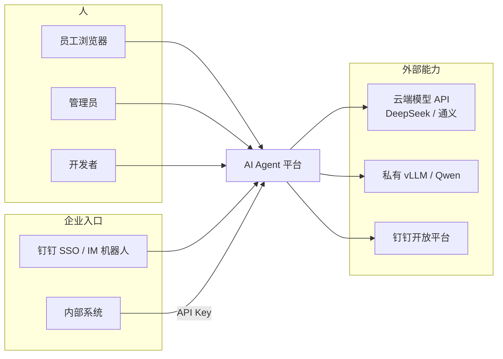

**员工**在商店选 Agent、开逻辑会话、发消息；也可在钉钉 @ 机器人（查询类，敏感操作被拒并引导到 Web）。**管理员**管目录、配额、审批、知识库、用户与审计。**内部系统**用 API Key 触发一次性任务。

### 3.2 技术上下文

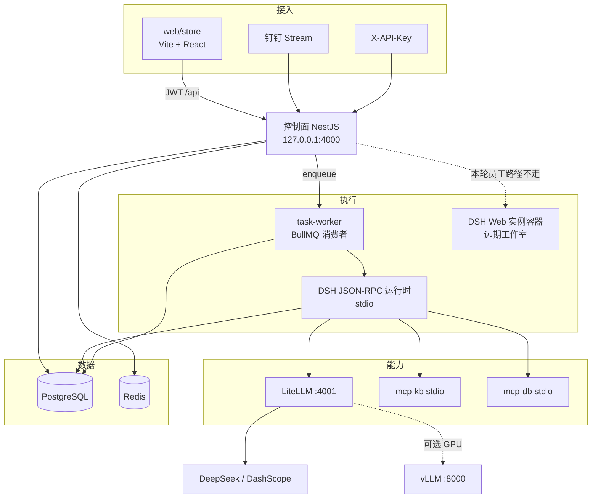

**范围以内**：`apps/control-plane`、`web/store`、`services/mcp-*`、`configs/`、`dsh-source/packages/platform/task-worker`、平台自有缝 `session-persistence-pg` / `credentials-pg`、公司 preset 与 profile。

**范围以外**：DSH 内核实现（只当黑盒运行时）、模型训练、对象存储附件（设计有、本轮对话路径未接 S3）、OTel 公司日志平台对接（导出器在 DSH，平台 collector 未作为一等公民部署）。

### 3.3 仓库物理边界

```
ai-agent-platform/
  apps/control-plane/          企业外壳 API（NestJS）
  web/store/                   商店 / 对话 / 管理 / Skill
  services/mcp-kb/             知识库 MCP
  services/mcp-db/             只读库 MCP
  configs/gateway/             LiteLLM compose + 路由
  configs/company-profile/     公司 DSH profile 源
  .dsh-home/presets-company/   运行时 preset 根
  dsh-source/                  vendor DSH + 平台耦合包
    packages/platform/task-worker/
    packages/session/session-persistence-pg/
    packages/credentials/credentials-pg/
```

平台分两层：**独立组件**（控制面、MCP、UI、迁移）与 **DSH 耦合组件**（必须在 `dsh-source` 工作区构建，依赖 `@deepseek-ai/*`）。

---

## 4. 方案策略

| 策略 | 做法 | 放弃的 |
|---|---|---|
| **外壳 + 内核** | 企业能力全部在控制面；DSH 只跑任务/（远期）Web 实例 | 多租户改造 DSH |
| **逻辑 RPC 会话（D22）** | `POST /sessions` 只写 `type=rpc` 行，不 spawn 容器 | 每用户常驻 Web 实例作为员工主路径 |
| **任务池执行** | 控制面生产 BullMQ job；Worker 用 SDK `harness.run(task, sessionId)` | 浏览器直连 DSH |
| **统一模型出口** | DSH 只配一个 OpenAI 兼容端点 → LiteLLM | 每个模型一个 DSH adapter |
| **MCP 挂能力** | RAG/只读 SQL 做成 MCP Server，preset/worker cordis 挂载 | 把检索写进 agent-loop |
| **缝替换存储与密钥** | PG SessionPersistence；PG/HTTP Credentials Provider | 每进程本地 `.credentials.yaml` 当生产源 |
| **认证前置** | 控制面发 JWT；dev 登录仅本地；oidc 直连钉钉 OAuth | 在 DSH 内做登录 |
| **单体控制面** | Nest 模块内聚，一个进程 | 过早拆微服务 |
| **PG 单库多 schema** | 平台表 + `dsh_sessions` schema | 一上来分库 |
| **fail-closed 数据面** | mcp-db：连接只读 + 语句校验 + 表白名单 | Agent 直接拿写库连接 |

---

## 5. 构建块视图

### 5.1 白盒：整体分层

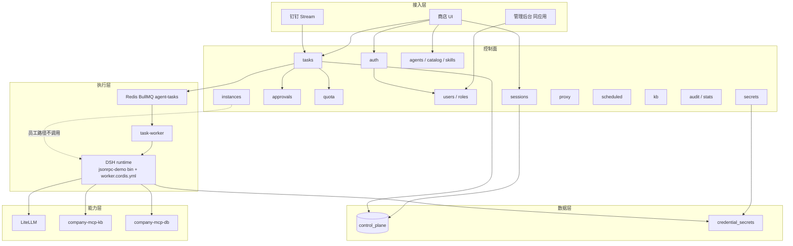

### 5.2 控制面模块（Level 2）

`AppModule` 组装如下（`apps/control-plane/src/app.module.ts`）。进程入口 `main.ts`：Fastify、CORS、`/api` 前缀、绑定 `127.0.0.1:${CP_PORT||4000}`。

| 模块 | 职责 |
|---|---|
| `CommonModule` | 全局：`PgStore`、`AuditStore`、JWT、`AuthGuard`、`PermissionGuard`、角色与 DSH preset 策略 |
| `AuthModule` | `dev` 签发 JWT；`oidc` 钉钉授权码（无 discovery，端点写死） |
| `UsersModule` | 用户/部门/禁用；dev 种子；PG hydrate |
| `SessionsModule` | 逻辑会话 CRUD；关会话时若有存量 `instanceId` 则 stop |
| `InstancesModule` | 编排门面：`memory` \| `docker`（podman）；空闲回收；**员工开对话不再调用** |
| `TasksModule` | 落 `tasks` → 配额门 → 审批门 → `Queue('agent-tasks')` |
| `ApprovalsModule` | 授权存储、多级链、TTL 撤销、通过后 `enqueue` |
| `QuotaModule` | user→dept→all 策略；`reject`/`warn`；告警可处置 |
| `AgentsModule` | Agent 商店：preset 文件生成、提审、可见性、审批链、revision |
| `CatalogModule` | 连接器 / 工具 / 组合图（节点 agent\|tool\|gate），图运行 |
| `SkillsModule` | Skill 草稿、版本审核、反馈、变更请求、站内通知 |
| `ScheduledModule` | cron / daily / every；时区；失败日志 |
| `ImModule` | 钉钉 Stream、preset 关键词路由、敏感词守卫、结果回推 |
| `SecretsModule` | vault CRUD + `GET /internal/secrets/:ref` |
| `KeysModule` | API Key 签发（明文一次）/ hash / scope |
| `KbModule` | 知识库文档可见性、ingest、试搜（管 mcp-kb） |
| `AdminModule` | 用户、角色定义、权限 overlay、会话检索、只读模型配置 |
| `AuditController` / `StatsController` | 审计查询、用量聚合 |
| `ProxyController` | JWT + 归属 + `x-routing-secret` → 转发 Web 实例（员工路径 503 no instance） |

### 5.3 商店 UI（`web/store`）

Vite + React 单页。路由靠 hash：`store` / `chat` / `admin` / `skills`。`VITE_API_BASE` 默认 `/api`。

| 视图 | 作用 |
|---|---|
| `StoreView` | Agent / 组合图目录，开始对话 |
| `ChatView` | 多轮：`createSession` + `submitTask(sessionId)`，用任务结果拼消息 |
| `AdminView` | 工作台 / 配置 / 知识库 / 调查 |
| `SkillStoreView` | Skill 市场 |
| `AgentComposeView` / `GraphComposeView` | 编排草稿 |

`startChat`：按 preset 复用未关闭会话；创建失败文案为「会话创建失败，请稍后重试」（不再提实例）。

### 5.4 任务 Worker 与 DSH 运行时

独立进程 `dsh-source/packages/platform/task-worker/src/worker.ts`：

1. 消费 Redis 队列 `agent-tasks`
2. 读 PG `tasks` 行，解析 `payload.task` / `permissionMode` / `sessionId`
3. vault 解析 `GATEWAY_KEY` 等引用
4. `DeepSeekHarness` 拉起 `jsonrpc-demo` bin + `worker.cordis.yml`
5. `session_id`：有商店会话则复用；一次性任务（IM/cron/图）用 `task-{id}-a{attempt}` 隔离重试
6. 写回 `done`/`failed`；启动与周期扫描孤儿 `running` 任务

`worker.cordis.yml` 挂载：JSON-RPC server、credentials-pg、llm-deepseek（经网关）、sandbox、agent-spine（公司助手 persona，关闭 bash/jobs/skills）、mcp-kb、mcp-db、subagent/workflow、JSONL 会话根（worker 本地；共享事件链由 PG Provider 在交互 profile 侧承担）。

### 5.5 DSH 内核构建块（执行黑盒的内部）

DSH 是 Cordis 插件树。与平台对接时只需记住：

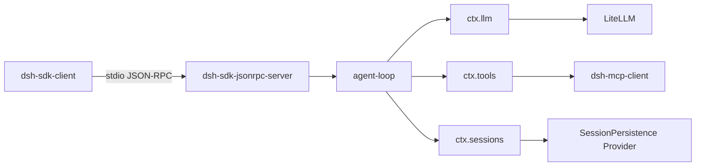

一次 **step** = 一次模型请求 + 其工具调用；一次 **turn** = 零或多 step。模型可见内容必须能从会话日志重建。

### 5.6 能力层 MCP

| 服务 | 工具 | 安全模型 |
|---|---|---|
| `services/mcp-kb` | `knowledge_search` | 按 `user.departments/roles` 过滤；语义索引优先，缺失回退关键词 |
| `services/mcp-db` | `list_tables` / `query_readonly` | `default_transaction_read_only`、单 SELECT、表白名单、LIMIT、statement_timeout |

传输：worker 用 **stdio** 拉起 `node .../dist/index.js`。kb 另支持 `--http` streamable-http（控制面管理/试搜）。

### 5.7 Agent 目录（代码中的产品）

公司 preset 根 `.dsh-home/presets-company/`：

| id | 产品名 | 场景 |
|---|---|---|
| `assistant` | 通用助手 | 底座 |
| `hr-assistant` | HR 制度助手 | 制度/请假/报销问答 |
| `report-builder` | 数据报表助手 | 只读查库；描述中钉死私有路由、查询需审批 |
| `doc-search` | 研发文档检索 | 规范/FAQ |
| `requirement` | 需求助手 | 需求挖掘 |

控制面 `AgentsService` + `AgentComposer` 把商店元数据写成 `preset.yml` / `agent.cordis.yml`。另有 **组合图**（catalog graphs）：agent/tool/gate 节点，运行时逐步 invoke。

---

## 6. 运行时视图

### 6.1 员工商店对话（主路径，D22）

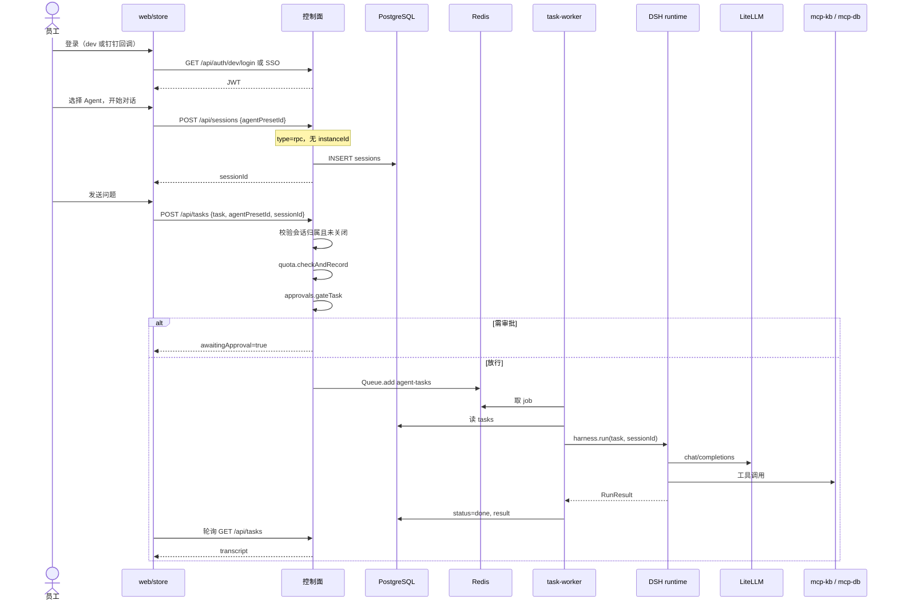

### 6.2 钉钉 IM（一次性任务，不绑商店会话）

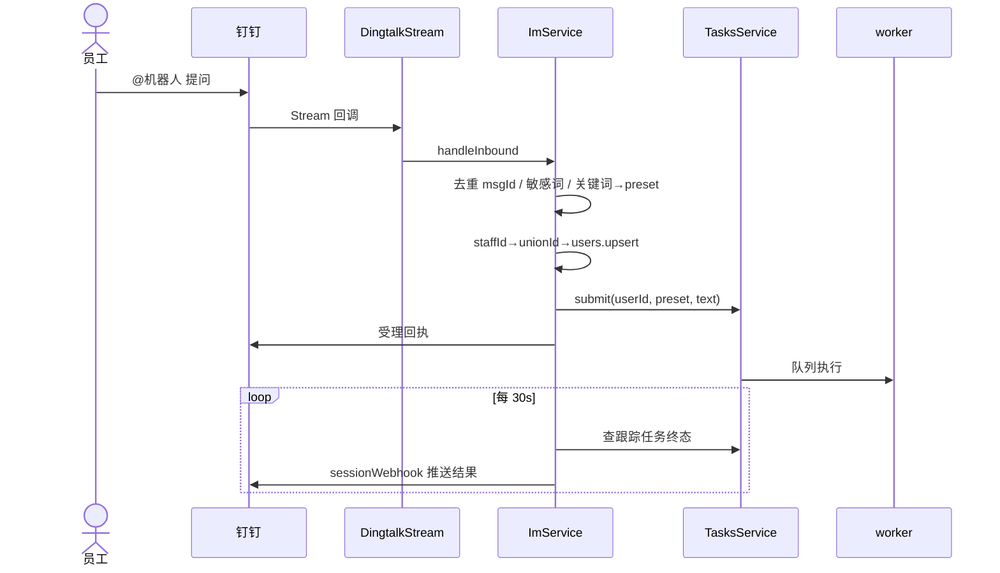

敏感操作（删除/批准/非咨询语境的付款等）直接拒绝，引导到 Web 审批。

### 6.3 任务提交门（配额 + 审批）

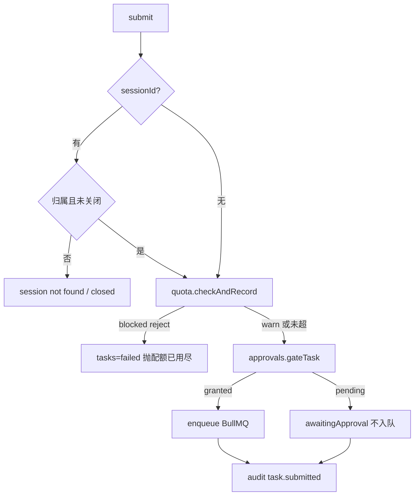

审批语义（`ApprovalService`）：

- preset `approvalLevel=none`：直接过
- `self`：近期授权命中则过，否则 pending（本人确认）
- `manager`：`approval_chain` 角色逐级批，默认 `['admin']`；`decide` 校验当前层角色

通过后控制器回调 `TasksService.enqueue`。TTL 默认 24h，定时 `approval.expired`。

### 6.4 DSH 一轮（内核）

```mermaid
sequenceDiagram
  participant SDK
  participant Loop as agent-loop
  participant LLM
  participant Tools

  SDK->>Loop: run(task, session_id)
  Loop->>Loop: turn/start
  Loop->>Loop: agent/pre-step
  Loop->>LLM: agent/request → llm/stream
  LLM-->>Loop: assistant/message
  alt 需要工具
    Loop->>Tools: tool/call
    Tools->>Tools: pre-execute / execute / post-execute
    Tools-->>Loop: tool/result
    Loop->>LLM: 下一 step
  end
  Loop-->>SDK: turn/end
```

### 6.5 认证

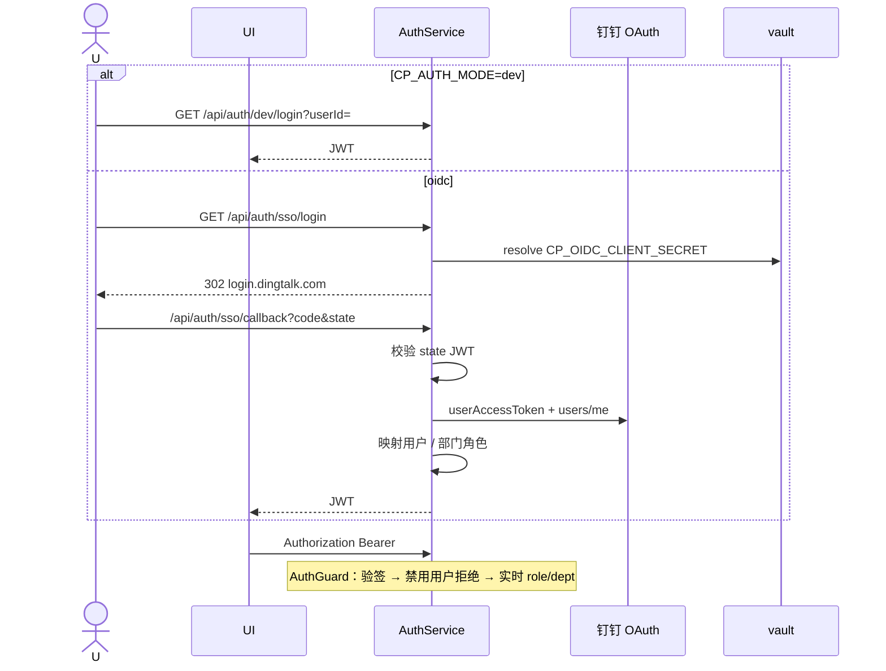

内部系统：`POST /api/service/trigger`，`ApiKeyGuard` + `scope=task:create`。Key 只存 sha256。

### 6.6 会话与实例生命周期

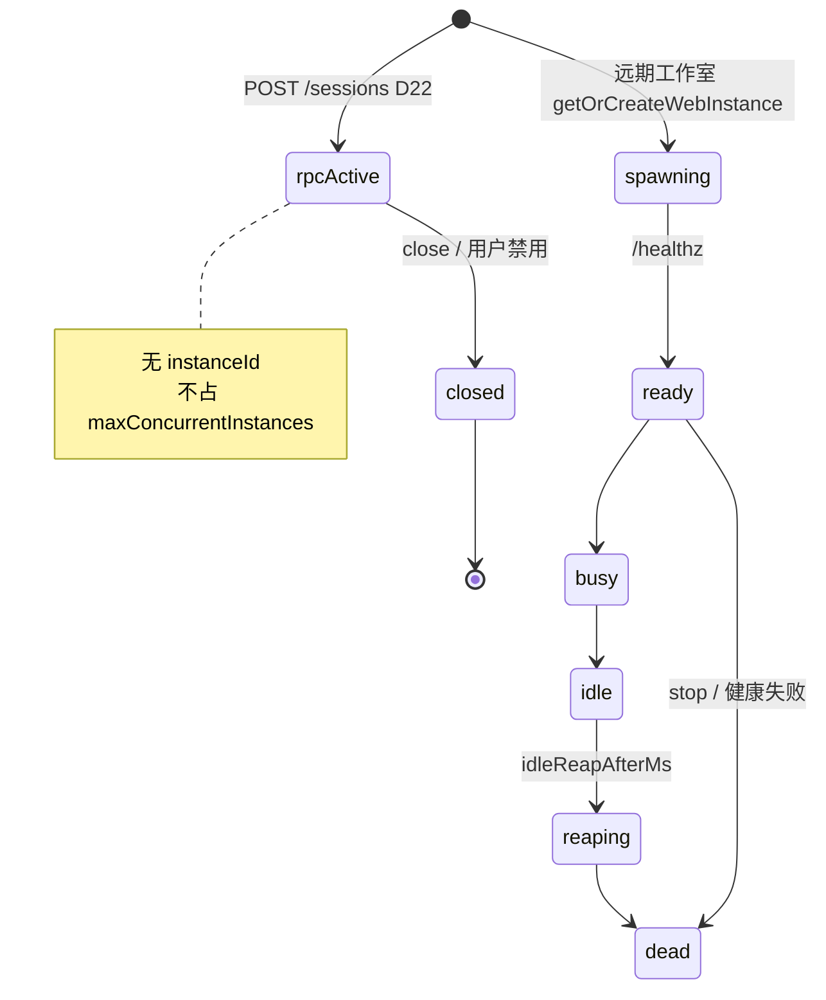

存量 `type=web` 且带 `instanceId` 的行：关闭时仍 `instances.stop`。`/proxy/:sessionId/*` 对 rpc 会话返回 503 `no instance`。

### 6.7 定时任务

控制面进程内 tick：`daily HH:MM` / `every Nm|Nh` / 5 段 cron，任务级 `timezone`（默认 `Asia/Shanghai`）。触发走同一 `TasksService.submit`（可再进审批）。结果写入 `scheduled_run_logs`，失败审计 `scheduled.failure`。

### 6.8 组合图运行

`POST /api/graphs/:id/run`：按拓扑执行节点；`tool` 节点经 `invoke.ts` 调 HTTP 或只读 PG（连接器 secret 从 vault 取）；`gate` 条件边；`onError` stop/continue。不经过 DSH 模型，除非节点是 agent（再提交任务）。

---

## 7. 部署视图

### 7.1 本地/试点拓扑（`RUN-LOCALLY.md`）

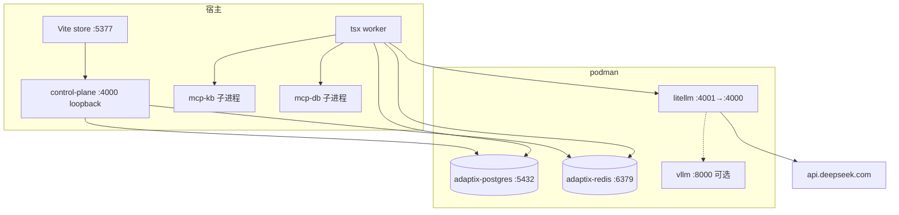

控制面**不**对公网监听；SSO 回调域名需打到能访问 `:4000` 的入口（生产应再加 TLS 反代，仓库内无 Traefik/Caddy 编排文件）。

### 7.2 进程与端口

| 进程 | 默认地址 | 启动 |
|---|---|---|
| 控制面 | `127.0.0.1:4000` | `apps/control-plane`：`tsc` 后 `node dist/main.js`（不要用 tsx 跑 Nest，缺 decorator metadata） |
| 商店 | `:5377`（Vite） | `web/store` `npm run dev` |
| Worker | 无 HTTP | `dsh-source/packages/platform/task-worker` `tsx src/worker.ts` |
| LiteLLM | 宿主 `4001` | `configs/gateway` podman-compose |
| vLLM | `8000` | 需 NVIDIA CDI；macOS 不起，只配 `VLLM_BASE_URL` |
| mcp-kb HTTP | `8787` 可选 | `--http` |
| DSH Web 容器 | 动态映射 | `CP_ORCHESTRATOR=docker`，镜像 `CP_DSH_WEB_IMAGE` |

仓库内 `apps/control-plane/docker/Dockerfile` 仍是 **busybox httpd 冒烟镜像**（`/healthz`），不是完整 company-dsh-web。

### 7.3 基础设施依赖

| 依赖 | 用途 |
|---|---|
| PostgreSQL 16 | 平台元数据 + vault +（可选）`dsh_sessions` + mcp-db 只读库 |
| Redis | BullMQ `agent-tasks` |
| 对象存储 S3 | 设计用于附件；员工对话路径未作为主存储 |
| GPU 节点 | 私有 Qwen；当前实测走 `cloud/deepseek` → `deepseek-v4-flash` |

### 7.4 配置注入

关键 env（完整列表见 `RUN-LOCALLY.md` / `.env.example`）：

- 控制面：`DATABASE_URL`、`CP_REDIS_URL`、`CP_AUTH_MODE`、`CP_JWT_SECRET`、`CP_ORCHESTRATOR`、`CP_MAX_INSTANCES`、`CP_ROLE_MAP_BY_DEPT`
- 密钥：`SECRETS_MASTER_KEY`；网关 master 以 `GATEWAY_KEY` 入 vault
- Worker：`DSH_MODEL`（`cloud/*` 则打网关）、`DEEPSEEK_BASE_URL`、`CP_WORKER_CONCURRENCY`（默认 2）、同用户串行在**单 worker 进程内**保证

### 7.5 数据迁移

`apps/control-plane/migrations/`：`001` 元数据 → `002` 任务 → `003` 审批 → `004` 配额 → `005/010` 定时 → `006` vault → `007` 用户 → `008` Agent 编排 → `009` 配额告警 → `011` 自定义角色 → `012` 多级审批 → `013` 配额唯一 → `014/015` 组合目录与图版本 → `016–020` Skill 市场。

---

## 8. 横切概念

### 8.1 安全

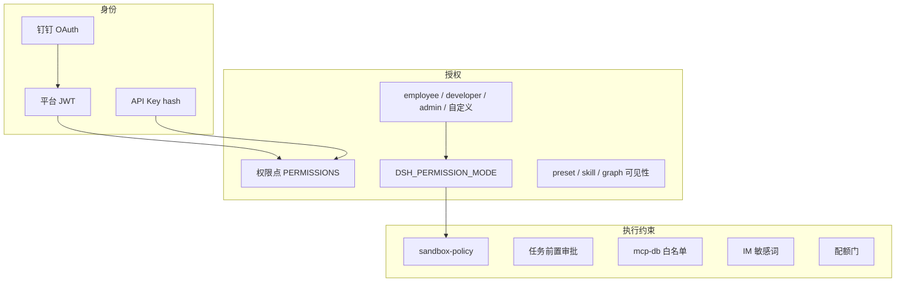

- **三重代理校验**（工作室路径）：JWT → `session.userId` → `x-routing-secret`
- **权限点**集中在 `permissions.ts`；自定义角色存 `role_definitions`
- 角色→沙箱：employee=`workspace-write`，developer/admin=`danger-full-access`；`CP_DEPT_PERMISSION` 可覆盖
- 容器解析密钥走 HTTP `/api/internal/secrets`，**不持有** vault 主密钥；worker 可直连 PG 解密
- 审计 payload 不写明文密钥；`describe` 无明文

### 8.2 身份与组织

- 平台用户 id 与钉钉 `unionId`（IM）/ OAuth 用户对齐
- 部门名映射角色：`CP_ROLE_MAP_BY_DEPT`
- 禁用用户：JWT 立即拒绝 + `closeAllForUser`
- 组织架构**定时全量同步尚未实现**（STATUS / Fog）

### 8.3 可观测与审计

- 控制面：`audit_events`（`auth.login`、`session.*`、`task.*`、`approval.*`、`proxy.*`、`quota.*`、`scheduled.failure`…）
- 管理：`GET /api/admin/audit/events`、`GET /api/admin/stats/usage`
- DSH：`dsh-session-telemetry-otel`、`dsh-token-meter`（平台配额当前按**任务次数**，token 列预留）
- LiteLLM 用量回调在配置里注释掉，未接公司日志平台

### 8.4 可靠性

Worker：**attempts=3**、指数 backoff、任务超时默认 5min、取消轮询、孤儿回收、同用户串行。多 worker 部署没有 per-user 队列分区。

控制面 PG 失败：会话/任务/审计等 **fail-soft 到内存**，生产不可作为高可用方案。

### 8.5 国际化和产品文案

员工 UI 与 persona 为中文助手（非编码 agent）。DSH 上游文档英/中双语，平台文档以中文为主。

### 8.6 「模型可见 ⇔ 已记录」

DSH 不变量：进模型的内容必须能从 session log 重建。平台商店 UI **尚未**把 DSH 事件链投影到对话窗，只用 task `finalResponse` 拼历史——这是产品层有意简化，不是内核破坏该不变量。

---

## 9. 架构决策

编号与 `docs/map.md` 对齐。完整权衡见 `spec.md` §4。

| ID | 决策 | 代码落点 |
|---|---|---|
| D1→**D22** | 员工路径 = JSON-RPC 任务池；`POST /sessions` 只建逻辑会话 | `SessionsService.create` |
| D2 | 认证在平台/反代，DSH 无认证 | `AuthGuard`；控制面 loopback |
| D3/D11 | LiteLLM 统一 OpenAI 兼容出口 | `configs/gateway`；worker `apiKeyEnv=GATEWAY_KEY` |
| D4 | RAG 为 MCP，不进内核 | `services/mcp-kb` |
| D5 | 共享 SessionPersistence → PG | `dsh-session-persistence-pg` |
| D6 | Agent = preset + 商店目录 | `agents` + `.dsh-home/presets-company` |
| D7 | 只依赖能力缝 | vendor `dsh-source`，平台包在 `packages/platform` 等 |
| D8 | 钉钉 OIDC 首发 | `AuthService` 硬编码钉钉 URL |
| D9 | NestJS + Fastify | `main.ts` |
| D10 | Docker/podman 起步 | `ContainerOrchestrator` |
| D12 | 部门标签→角色 | `UsersService` + `CP_ROLE_MAP_BY_DEPT` |
| D13 | 私有 Qwen 即插 | LiteLLM `private/qwen-72b` + env |
| D15 | 单库多 schema | `control_plane` + `dsh_sessions` |
| D16 | 审计 180 天 | 策略；清理未代码化 |
| D17 | pgvector + bge-m3 目标 | kb 现为 NVIDIA embedding + 文件索引，替换未完成 |
| D18 | 机密钉死私有路由 | **网关守卫未实装** |
| D19 | 试点 4 场景 | 4+1 preset；IM 关键词路由 |
| D20 | 自建 vault | `CredentialVault` AES-256-GCM |
| D21 | PG Provider 平台自有 | 不贡献上游直至 tagged release |

**D22 相对 ADR-1 的修正**：交互不再等于「每用户 Web 实例」。实例编排、`/proxy`、`routing_secret` 列保留给工作室，本轮不删。

---

## 10. 质量需求

### 10.1 质量树（当前可验证）

| 场景 | 期望 | 验证方式 |
|---|---|---|
| 开对话不占容器 | `type=rpc` 且 `instanceId` 空 | `sessions.service.test.ts` |
| 越权 | employee 调 admin API → 403 且审计 | 权限单测 + 07 实测记录 |
| 配额 | 超限 429，queued 行标 failed | `quota.service.test.ts`、任务 submit |
| 只读 SQL | INSERT 失败；白名单外表拒绝 | mcp-db 设计 + smoke |
| 密钥 | 列表无明文；HTTP resolve 无 master | `secrets` / `credentials-pg` 测试 |
| 任务可靠 | 重试/超时/取消/孤儿 | worker 注释与 STATUS 19 |
| 审批链 | 非当前角色 decide 失败 | `approval.service.test.ts` |
| IM 安全 | 敏感句不入队 | `im.service.test.ts` |

### 10.2 未达质量（已知缺口）

- 网关 D18 路由守卫（机密任务打到云端的强制拒绝）
- token/成本级配额（列已有，执行口径仍是请求数）
- 对话流式与工具步骤 UI
- 多 worker 同用户串行
- WebSocket/`/proxy` 升级（工作室）
- 组织架构定时同步
- 私有 vLLM 路径在本环境未作为默认实测
- 真实钉钉群 @ 验收仍待真人

### 10.3 容量（设计假设，非压测数字）

规格目标 50–500 人。实例上限 `CP_MAX_INSTANCES` 默认 30，**已与员工开对话解耦**。Worker 默认并发 2。配额默认全员每日 20 任务（`004_quota.sql`）。

---

## 11. 风险与技术债

| 风险/债 | 影响 | 现状 |
|---|---|---|
| DSH 0.1.0-rc 破坏性变更 | 缝接口/会话格式漂移 | 锁 vendor；平台 Provider 自有 |
| Worker cordis 写死本机绝对路径 | 换机器/CI 即 MCP 挂载失败 | `worker.cordis.yml` 中 mcp args 为开发机路径 |
| 商店 transcript ≠ DSH 事件链 | 刷新/多端与真实 log 不一致 | D22 非目标 |
| PG 回退内存 | 误把无 DATABASE_URL 当生产 | 模块内 persist() 分支 |
| 单 worker 假设 | 水平扩展丢同用户串行 | `RUN-LOCALLY.md` 已写 |
| 控制面无 TLS | 依赖前置反代 | 仅 loopback |
| 冒烟 Web 镜像 ≠ 真 DSH Web | 工作室路径易被误测为「已产品化」 | busybox Dockerfile |
| 语义检索栈与 D17 目标不一致 | 后续要换 pgvector/bge-m3 | kb `vector-index.ts` |
| IM 与商店会话不互通 | 钉钉每问一次孤立 session_id | D22 非目标 |
| 审计 TTL 未执行 | 180 天策略无 job | 债 |
| 组合图与 DSH 工作流两套编排 | 心智与排障成本 | catalog graphs vs `dsh-workflow` |
| README 仍写商店「无构建」 | 文档漂移 | `web/store` 已是 Vite 应用 |

---

## 12. 术语表

| 术语 | 含义 |
|---|---|
| **DSH** | DeepSeek Harness，Agent 运行时内核 |
| **Cordis** | DSH 的插件框架：服务、事件、可逆 effect |
| **能力缝** | Service Definition + Provider + Consumer；例如 SessionPersistence、Credentials |
| **Preset** | 一个 Agent 产品：目录内 `preset.yml` + `agent.cordis.yml` |
| **逻辑 RPC 会话** | 控制面 `sessions` 行，`type=rpc`，作为商店多轮的 `session_id`，不对应容器 |
| **Web 实例 / 工作室** | 每用户 DSH Web 容器；本轮无产品入口 |
| **任务** | `tasks` 表一行 + BullMQ job；Worker 一次 `harness.run` |
| **控制面** | `apps/control-plane`，企业外壳 API |
| **Worker** | `@company/platform-task-worker`，SDK 驱动运行时 |
| **LiteLLM / 模型网关** | 统一 `/v1/chat/completions`；模型名 `cloud/deepseek`、`private/qwen-72b` |
| **MCP** | Model Context Protocol；平台用 stdio 挂 kb/db |
| **routing_secret** | 会话代理令牌；rpc 会话仍生成但不消费 |
| **vault / D20** | PG 中 AES-256-GCM 凭据表 + `dsh-credentials-pg` |
| **审批门** | 任务入队前按 preset `approvalLevel` / `approval_chain` 拦截 |
| **Skill** | 平台级可审核的提示/流程资产（016–020），与 DSH `dsh-skill` 包不同层 |
| **组合图** | 控制面 catalog 里的 agent/tool/gate 图，非 DSH workflow 脚本 |
| **arc42** | 架构文档模板（本文结构） |

---

## 附录 A — 主要 HTTP 面

前缀均为 `/api`，除非注明。均需 JWT，除登录与 API Key 路由。

| 方法 | 路径 | 说明 |
|---|---|---|
| GET | `/auth/dev/login` | 开发登录 |
| GET | `/auth/sso/login` `/auth/sso/callback` | 钉钉 |
| GET | `/me` | 当前用户 |
| POST/GET | `/sessions` | 逻辑会话 |
| POST | `/tasks` | 商店发消息 |
| POST | `/service/trigger` | API Key 触发 |
| GET | `/agents` `/graphs` `/skills` | 目录 |
| GET | `/proxy/:sessionId/*` | 无全局前缀；工作室代理 |
| GET | `/internal/secrets/:ref` | 容器解析密钥 |
| \* | `/admin/*` | 用户、配额、审计、KB、实例、IM simulate… |

## 附录 B — 数据表（平台库）

核心：`users`、`departments`、`sessions`、`instances`、`audit_events`、`api_keys`、`agent_presets`、`tasks`、审批与授权、`quota_*`、`scheduled_*`、`credential_secrets`、`role_definitions`、catalog（connectors/tools/graphs/revisions）、skills（含 feedback/change_requests/notifications）。

DSH 事件：schema `dsh_sessions`（`sessions` + `events` append-only）。

## 附录 C — 文档地图

| 要查 | 去哪 |
|---|---|
| 为什么这么做 | `docs/spec.md`、`docs/map.md` |
| 外壳模块草图 | `docs/enterprise-shell.md` |
| D22 精确行为 | `docs/superpowers/specs/2026-08-27-logical-rpc-sessions-design.md` |
| 工单完成度 | `docs/STATUS.md` |
| 怎么在本机跑 | `docs/RUN-LOCALLY.md` |
| DSH 内核 | `dsh-source/docs/architecture.md` |
| 本文件 | 代码现状的 arc42 总览 |
